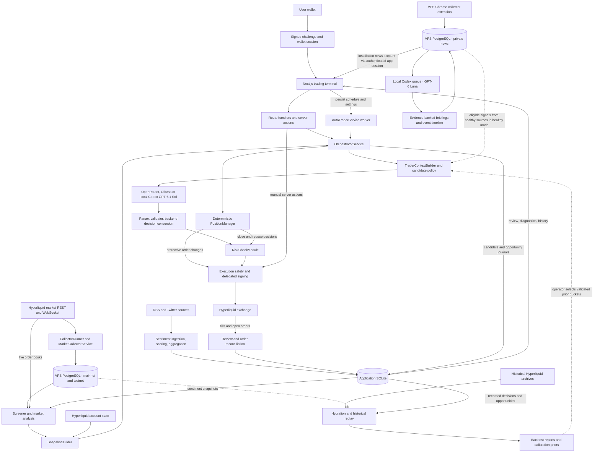
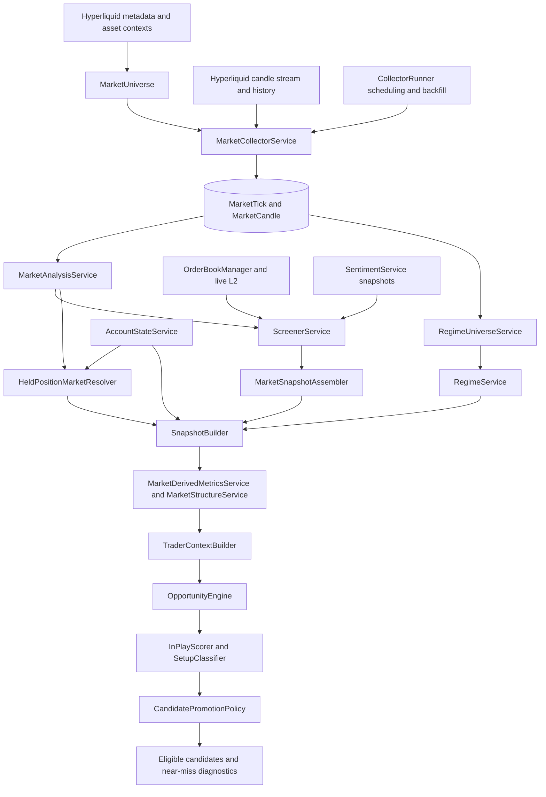
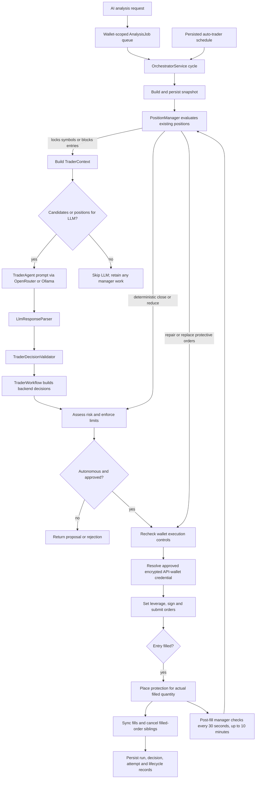
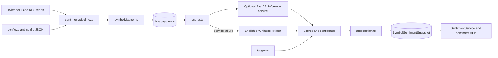
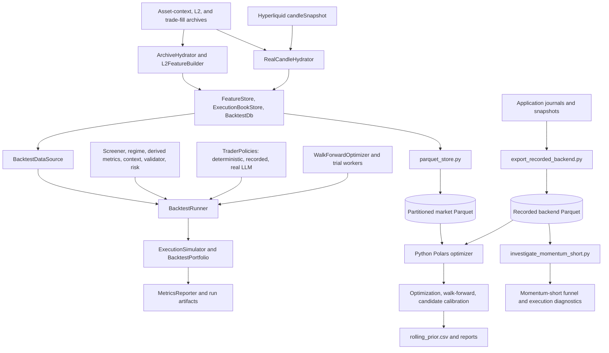

# How Centrypto works

Inspected on 2026-10-31, including the current uncommitted working-tree changes.

Centrypto is a Next.js trading terminal plus separate market, sentiment, and auto-trading workers. Hyperliquid supplies market/account data and executes orders. The backend discovers opportunities, builds bounded trade candidates, asks an LLM to decide, validates its response, applies risk checks, and signs approved orders with the user's delegated API wallet. Historical replay and calibration run alongside this live system.

The source review below now includes the news/Codex/VPS overhaul. Market and news
collection are deployed on RackNerd; the application directly reads PostgreSQL
through SSH. Local application/trading SQLite and backtest files remain on this
PC. [Operations and rollout](news-intelligence-operations.md) describes the live
deployment, model checks, source registry and observation gate. The source index
is in [module-index.md](module-index.md). RSSHub internals are outside this review.

## System map

Arrows show data or control flow. Dotted arrows show optional paths or explicit operator configuration.

The terminal also reads market REST/WebSocket data directly for its live feed. Browser display state is separate from the backend snapshot used for an autonomous decision.

## Processes and storage

| Process | Entry point | Responsibility |
| --- | --- | --- |
| Next.js application | `app/layout.tsx`, `app/page.tsx`, `app/api/**`, `app/actions/trade.ts` | Terminal, wallet sessions, market reads, analysis jobs, settings, review, manual orders. |
| VPS market worker | `centrypto-market` → bundled `scripts/start_collector.ts` | Collects both networks into PostgreSQL; 15-second ticks, 1m candle streams and history backfill. |
| VPS news collection | `collector/extension`, `collector/server.ts`, `collector/deploy` | Normal persistent Chrome, two leased collection tabs, private capture validation and direct PostgreSQL persistence. |
| Local inference | `scripts/start_local_runtime.py`, `scripts/start_intelligence_worker.ts`, `services/CodexQueueService.ts` | Reconnecting SSH tunnel, one durable inference slot, exact Luna/Sol models and quota/cancellation handling. |
| Auto-trader worker | `npm run auto-trader` → `scripts/start_auto_trader.ts` | Polls persisted enabled settings every 30 seconds, claims due wallet/network jobs, checks data readiness, and invokes the orchestrator. Per-wallet frequency defaults to 600 seconds and has a 60-second minimum. |
| Sentiment worker | `scripts/run_sentiment.ts` | Runs ingestion → scoring → aggregation every 15 minutes by default. Individual stages also have npm commands. |
| Optional Python inference service | `scripts/start_sentiment_service.sh` → `sentiment/service.py` | FastAPI scoring at port 8000; finance/news and social models, plus Chinese-to-English translation. TypeScript falls back to a lexicon when the service fails. |
| Optional RSSHub server | `rsshub-selfhost/` | An independent upstream feed adapter, accessed over HTTP through `RSSHUB_BASE`. It is not imported into the Next.js application. |
| Research jobs | `scripts/backtest_*.ts`, `scripts/backtest_parquet.py`, `backtest_py/` | Archive hydration, simulated trading, optimization, walk-forward evaluation, recorded-backend export, and calibration. |

These workers are not all started by `npm run dev`. API collector startup is
disabled. VPS collection runs independently of the PC; local inference resumes
from pending PostgreSQL evidence when the PC returns. The legacy sentiment
worker remains available for old public data but is not the private news pipeline.

| Store | Code/schema | Contents and actual path behavior |
| --- | --- | --- |
| Application database | `lib/db.ts`, `prisma/schema.prisma` | Uses `DATABASE_URL`; falls back to `prisma/backend.db`. Sessions themselves are signed cookies. The DB holds settings, encrypted API-wallet keys, risk controls, messages, sentiment, snapshots, jobs, candidate/opportunity journals, and trading/review records. |
| Mainnet market database | `lib/market-db.ts`, `prisma/runtime-market/schema.prisma` | Direct VPS PostgreSQL `mainnet` schema; app role is read-only. Old SQLite is an import source, not a runtime fallback. |
| Testnet market database | Same PostgreSQL client factory/schema | Direct VPS `testnet` schema with the same tables and role boundary. |
| Private news database | `lib/news-db.ts`, `prisma/news/schema.prisma` | Wallet-owned source/revision/event/analysis/briefing records. Public sentiment APIs never read this store. |
| Local inference/audit | `CodexJob`, `CodexRuntime`, `NewsRunContext` in app SQLite | Durable priority jobs and leases, model health, and briefing snapshots pinned to trading runs. |
| Historical feature database | `src/backtest/BacktestDb.ts` | Normally `prisma/backtest.db`, configurable by backtest arguments. Stores historical features, candles, ticks, and execution-book data. |
| Research datasets | `backtest_py/parquet_store.py`, `backtest_py/export_recorded_backend.py` | Partitioned Parquet market data and recorded backend events for Python replay/calibration. |
| Reports and calibration | `data/backtests/<runId>/`, configured calibration output directories | JSON/CSV metrics, coverage, decisions, equity, trades, and calibration outputs. Live-prior validation reads `data/calibration/latest/rolling_prior.csv`. |
| Trading logs | `lib/log/tradingLogger.ts` | Daily JSONL files under `logs/trading/`. |

## Market-data and opportunity flow

1. The collector filters delisted assets, stores periodic price/funding/open-interest/volume snapshots, streams candles, and fills missing history. Startup backfill prioritizes a small liquid universe before continuing through the remaining symbols.
2. Readiness checks require fresh ticks/candles and, by default, at least five symbols with 95% of a 48-hour 1m-candle window. A readiness failure blocks the auto-trader before a cycle.
3. The screener combines recent tick activity, historical technical metrics, sentiment, and order-book liquidity/cost. Discovery scoring and execution permission are separate: a symbol can be interesting but blocked for trading.
4. Snapshot construction always accounts for held positions, including fallback market data for positions absent from the screener. Regime detection uses a separate broader market universe, rather than only the final selected candidates.
5. Derived metrics add structure, costs, expected edge, liquidity, risk eligibility, and allowed playbooks. Context construction applies portfolio capacity, strategy restrictions, cooldowns, correlation, sizing, and promotion/demotion policy.
6. Opportunity diagnostics include discovered, blocked, candidate, and near-miss states. `OpportunityJournalService` records these states and later computes forward outcomes. Promotion can use explicitly configured historical-prior buckets; offline results do not automatically authorize live trades.

## Trading and position management

Manual AI analysis returns proposals; automatic execution is conditional. Browser-confirmed manual execution uses `placeOrderAction`, which checks the wallet session, kill switch, daily-loss guard, leverage, and delegated credential. That manual action does **not** run the entire candidate/LLM/RiskCheckModule pipeline. Automated orders pass through that fuller pipeline before the execution-time guard.

The LLM receives a reduced `TraderContext`: portfolio state, existing positions, allowed candidates, sizing/risk fields, and near misses. It can open/skip candidates and hold/reduce/close positions. The validator rejects unknown candidates or positions, duplicates, invalid sides/playbooks, and out-of-bounds decisions. `TraderWorkflow` converts valid choices to backend orders; the risk module can reject or modify them. No-work cycles skip inference.

The deterministic position manager can act without an LLM. It evaluates emergency loss/liquidation exits, missing stops, breakeven protection, stale protective orders, time stops, and profit protection. Protective-order repairs use a dedicated order-action path; close/reduce decisions use risk assessment. Its short post-fill timer is process-local and bounded, rather than a durable permanent position supervisor.

## Service modules

All 24 files in `services/` are covered here.

| Module | Role |
| --- | --- |
| `CollectorRunner` | Collector lifecycle, prioritized backfill, request-time readiness and freshness checks. |
| `MarketCollectorService` | Fetches tick snapshots, maintains candle streams, and writes/backfills market data. |
| `MarketUniverse` | Pure helpers for active assets, valid ticks, volume, and backfill priority. |
| `MarketAnalysisService` | Candle-based returns, volatility, RSI, bands, ATR, MACD, volume signals, and book metrics. |
| `OrderBookManager` | Maintains subscriptions and calculates depth, spread, imbalance, and pressure. |
| `ScreenerService` | Screens/ranks markets; combines discovery signals with independent execution diagnostics. |
| `RegimeUniverseService` | Builds the wider market set used for regime inference. |
| `RegimeService` | Infers market-wide regime and supporting measures. |
| `MarketSnapshotAssembler` | Converts screened results to normalized market snapshot entries. |
| `HeldPositionMarketResolver` | Resolves market data for held symbols missing from screening results. |
| `AccountStateService` | Builds equity, positions, PnL, exposure, capacity, and account constraints from Hyperliquid. |
| `MarketStructureService` | Describes impulse, pullback, breakout, and other price-structure context. |
| `MarketDerivedMetricsService` | Adds execution costs, edge, liquidity, trigger, and risk/playbook metadata. |
| `SnapshotBuilder` | Coordinates account, markets, sentiment, regime, presets, and risk constraints. |
| `TraderContextBuilder` | Turns a snapshot into bounded candidates and managed positions, including cooldown/correlation and promotion policy. |
| `OrchestratorService` | Coordinates jobs, snapshots, manager actions, inference, validation, risk, execution, logging, and journals. |
| `AutoTraderService` | Stores wallet/network settings and atomically claims and runs due cycles. |
| `AutoTraderOrderManagementService` | Reads/cancels open orders and reconciles protective OCO siblings. |
| `AutoTraderReviewService` | Records runs, before/after positions, decisions, attempts, fills, lifecycle state, and management events; builds review responses. |
| `OpportunityJournalService` | Persists the opportunity funnel, symbol diagnostics, and forward outcomes. |
| `TradeHistoryService` | Combines exchange fills and local records into history/analytics. |
| `SentimentService` | Reads persisted sentiment for the trading path; also supports a separate payload/VADER analysis method. Missing snapshots default to neutral. |
| `PriceAlertsService` | Wallet-owned alert CRUD, reset, and price-condition evaluation. Its evaluator currently has no caller. |
| `MarketDataService` | Legacy shell/type container. Its comment directs callers to collector/analysis services; no application callers were found. |

## Supporting libraries

| Module group | Files and responsibilities |
| --- | --- |
| Auth | `lib/auth/wallet-session.ts`: challenge signatures, signed cookie sessions, ownership normalization; `lib/auth/internal.ts`: internal bearer/header token. `middleware.ts` classifies API access and limits public reads; handlers enforce wallet ownership. |
| Exchange reads | `lib/hyperliquid-info.ts`: network-aware info calls; `lib/hyperliquid.ts`: compatibility re-export. |
| Exchange stream | `lib/hyperliquid-ws.ts`: subscriptions, reconnection, heartbeat, and shared network clients. |
| Exchange signing | `lib/hyperliquid-execution.ts`: SDK signing, nonce allocation, order formatting, entry/trigger/cancel/leverage requests. `lib/hyperliquidExecution.ts`: older `ExecutionEngine` wrapper, with no active application callers found. |
| Delegated credentials | `lib/hyperliquid-api-wallet.ts`: rejects the main-wallet key, checks agent delegation, encrypts stored keys, retrieves wallet/network-scoped credentials, and tracks use. |
| Exchange throttling | `lib/rate-limit/hyperliquid-limiter.ts`: keyed buckets, coalesced reads, caches/stale reads, and serialized account writes. State is process-local. |
| Databases | `lib/db.ts`: local app SQLite; `lib/market-db.ts`: direct mainnet/testnet PostgreSQL clients; `lib/news-db.ts`: private PostgreSQL news. Separate SQLite backtest client. |
| Configuration | `lib/agent-config.ts`, `lib/screener-config.ts`, `lib/auto-trader-config.ts`: strategy/risk/screening presets and normalization. `lib/screening-storage.ts`, `lib/activeNetwork.ts`: browser configuration/network persistence. |
| Candidate policy | `lib/candidate-promotion.ts`: normalized rules, structural flags, bucket keys, hashes/epochs. `lib/candidate-promotion-priors.ts`: CSV prior loading and validation of live buckets. `lib/trader/CandidatePromotionPolicy.ts`: promotion, demotion, and shadow decisions. |
| Opportunities | `lib/trader/OpportunityEngine.ts`, `InPlayScorer.ts`, `SetupClassifier.ts`: structure-based activity/setup assessment and diagnostic statuses. |
| Decision contract | `lib/trader/TraderDecisionValidator.ts`: bounded response checks; `TraderWorkflow.ts`: deterministic research provider, decision conversion, and ordered risk assessment; `playbook-utils.ts`: canonical playbooks. |
| Position management | `lib/trader/PositionManager.ts`, `position-management-policy.ts`, `position-management-math.ts`, `position-management-types.ts`: deterministic management actions, policies, calculations, and contracts. |
| Risk | `lib/risk/RiskCheckModule.ts`: action/market/playbook/cost/size/exposure/SL/TP gates; `shared.ts`: common risk-plan math; `kill-switch.ts`: wallet/network controls; `execution-safety.ts`: authoritative execution-time wallet and daily-loss checks. |
| Execution cost | `lib/trading/execution-cost.ts`: shared fee/spread/slippage cost calculation. |
| LLM | `prompts/TraderAgent.ts`: prompt/decision contract; `lib/llm/LlmResponseParser.ts`: JSON extraction, repair, normalization, and response parsing. Provider calls live in the orchestrator and research policy module. |
| Review/report helpers | `lib/auto-trader-review/review-utils.ts`: normalization, response extraction, identifiers, lifecycle/accounting helpers; `lib/auto-trader-activity-report.ts`: report aggregation. |
| Logging | `lib/log/safeLogger.ts`, `traderLog.ts`, `tradingLogger.ts`: redaction, cycle-scoped output, and JSONL decision logs. |
| Small helpers/contracts | `lib/trade-utils.ts`, `lib/utils.ts`, `types/snapshot.ts`, `types/trading.ts`, `types/auto-trader-review.ts`, `types/vader-sentiment.d.ts`. |

## Terminal and API modules

The home page mounts `LeftNavigation`, `TopHeader`, `TechnicalChart`, `HyperliquidFeed`, `SentimentPanel`, `PositionsTable`, and `TradingAndRisk`. `Providers` wraps `Web3Provider` and `TradingProvider`; `TradingContext` holds the selected symbol/network and wallet-session display state. `useAccountData` supplies account summaries.

| UI group | Modules |
| --- | --- |
| Wallet/account | `WalletConnect`, `HyperliquidApiWalletSettings`, `TopHeader`, `Web3Provider`, `Providers`, `context/TradingContext`, `hooks/useAccountData`. |
| Market workspace | `HyperliquidFeed`, `TechnicalChart`, `SentimentPanel`, `LeftNavigation`, `ScreeningParameters`. |
| Trading controls | `TradingAndRisk` mounts `TradeForm`, `AIAdvisor`, `LlmDecisionsLog`, and `AutoTraderReview`; `CandidatePromotionRulesPanel` is used by the configuration editor. |
| Positions/history | `PositionsTable` is mounted on the home page. The separate `OpenPositions` component exists but is not mounted there. |
| Research | `app/backtester/page.tsx` mounts `Backtester`. |
| Present but unmounted | `Dashboard`, `ExecutionPanel`, `PriceAlerts`, `OpenPositions`, and `AdvancedIndicators` have no mounted path from the current pages. `AdvancedIndicators` is imported by the home page but not rendered. |
| UI primitives | All 15 `components/ui/*` modules: badge, button, card, ConfigEditor, input, label, label-with-tooltip, popover, select, sheet, switch, table, tabs, toggle, tooltip. |

| Route family | Module path / access / role |
| --- | --- |
| Wallet sessions | `/api/auth/challenge`, `/verify`, `/session`, `/logout`: public session bootstrap/refresh/logout. |
| Public market data | `/api/candles`, `/api/indicators`, `/api/screener`, `/api/sentiment`, `/api/sentiment/[symbol]`, `/api/sentiment/model`, `/api/ai/models`. |
| Account state | `/api/hyperliquid/account`: wallet-session-bound account reads; it sits in the middleware's public-rate-limit class but checks the session in the handler. |
| AI jobs | `/api/ai/analyze`, `/cancel`, `/job-status`: wallet-scoped asynchronous analysis, cancellation, and polling. One running plus one queued job per wallet. |
| Auto-trader | `/api/auto-trader`: authenticated status/settings. |
| Review | `/api/auto-trader/review`, `/review/sync`: wallet-scoped review and fill synchronization. |
| Diagnostics and prior UI | `/api/auto-trader/diagnostics/symbol`, `/api/auto-trader/prior-buckets`: wallet-scoped reads. |
| Outcome processing | `/api/auto-trader/diagnostics/outcomes`: handler requires internal auth, although middleware classifies its parent as wallet-scoped. |
| Credentials/risk | `/api/hyperliquid/api-wallet`, `/api/risk/kill-switch`: wallet-scoped key management and risk controls. |
| History and alerts | `/api/trades`, `/api/alerts`: wallet-owned history/analytics and alert CRUD. |
| Internal jobs | `/api/backtest/run`, `/api/cron/sentiment`, `/api/ai/cleanup-jobs`, `/api/llm/history`: internal-token protected. |
| Deprecated execution route | `/api/trade/execute`: returns HTTP 410. Actual manual execution is the authenticated server action in `app/actions/trade.ts`. |

Wallet login establishes identity; it does not sign each exchange order in the browser. Backend execution uses an approved delegated API-wallet credential. The server-key fallback is explicitly limited to opt-in development/testnet execution. Internal tokens must stay server-side.

## Sentiment modules

`pipeline.ts` ingests and deduplicates text, maps symbols, scores pending messages, attaches tags, and creates aggregate snapshots. `config.ts` loads feed/symbol/aggregation/lexicon configuration and adds default RSSHub sources. `aggregation.ts` applies time/source/confidence weighting and baseline/disagreement calculations. `service.py` is the optional model server, not the scheduler. The separate `/api/cron/sentiment` path uses the service's payload analyzer; it does not replace the full standalone ingestion pipeline.

## Historical replay and calibration

| TypeScript module | Responsibility |
| --- | --- |
| `ArchiveHydrator` | Selects historical universe, downloads archives, builds/stores features and optional execution data. |
| `RealCandleHydrator` | Hydrates real 1m execution candles from snapshot API or historical fills; preserves source labels. |
| `BacktestHydration` | Coordinates archive/real-candle preflight for run/optimizer commands. |
| `BacktestDb` | Creates/opens the historical SQLite schema. |
| `L2FeatureBuilder` | Derives historical book/market features. |
| `FeatureStore` | Persists and queries feature time series. |
| `ExecutionBookStore` | Stores historical execution-book snapshots. |
| `BacktestDataSource` | Builds historical snapshots and coverage, using shared screener logic. |
| `BacktestRunner` | Advances time, builds contexts, obtains/validates decisions, applies risk, and writes results. |
| `TraderPolicies` | Deterministic baselines, recorded decisions, real-LLM decision provider, and research management policies. |
| `ExecutionSimulator` | Simulates execution costs, fills, and stop/take-profit behavior. |
| `BacktestPortfolio` | Tracks simulated positions, balance, realized/unrealized PnL, and equity. |
| `MetricsReporter` | Calculates aggregate performance metrics and curves. |
| `WalkForwardOptimizer` | Searches parameters and evaluates train/test windows. |
| `OptimizerTrialWorker.ts`, `OptimizerTrialWorker.cjs` | Worker-thread trial execution and TypeScript loader shim. |
| `BacktestTypes` | Run, coverage, feature, execution, simulation, and optimizer contracts. |

The Python path is substantial application code: `backtest_py/optimizer.py` handles Polars replay, optimization, walk-forward, and recorded-candidate calibration; `parquet_store.py` exports/loads partitioned market datasets; `export_recorded_backend.py` exports recorded application decisions/opportunities/events; `investigate_momentum_short.py` analyzes the recorded short-opportunity funnel. `__init__.py` marks the package, and three Python test modules cover these paths. TypeScript's `scripts/backtest_optimize_py.ts` coordinates hydration/export before launching Python. The two thin Python scripts in `scripts/` are CLI wrappers.

The TypeScript engine shares core trading modules but is not identical to live execution: it supplies a zero-correlation provider, uses a simulated portfolio/executor, and has separate selectable management policies. Python implements corresponding logic separately. Changes to strategy/risk rules therefore need parity checks across both research paths. Real, synthetic, and mixed execution candles are labeled; synthetic-candle SL/TP paths are approximate. `examples/backtest_runner_demo.py` is a separate synthetic SMA demonstration.

## Scripts, configuration, and tests

`package.json` is the command index. `scripts/start_collector.ts`, `start_auto_trader.ts`, and `run_sentiment.ts` are worker entry points. `ingestTwitter.ts`, `ingestRss.ts`, `scoreMessages.ts`, and `aggregateSentiment.ts` expose sentiment stages. `download_hl_l2.ts`, `backtest_features.ts`, `backtest_candles.ts`, `backtest_run.ts`, `backtest_optimize.ts`, `backtest_optimize_py.ts`, `backtest_walkforward.ts`, and the Python wrappers provide research tools. The remaining scripts are backfill, migration, verification, reporting, reproduction, or debugging utilities; their direct imports are listed in the module index. Their presence does not mean they run with the web app.

`config/` contains aggregation, source feeds, English/Chinese lexicons, and symbol aliases. Prisma schemas/migrations define application and market persistence. Root Next/TypeScript/Tailwind/ESLint/Vitest configuration controls the application toolchain; `.github/workflows/ci.yml` defines CI. Root browser/screenshot/prompt/reproduction scripts are development helpers, rather than application runtime modules.

## Findings and verification

These observations describe the inspected working tree. This review adds documentation; it does not change runtime behavior.

| Finding | Evidence | Implication |
| --- | --- | --- |
| Process deployment | `ecosystem.config.js` now describes local tunnel/inference supervision. VPS collectors use systemd. | Neither launcher starts or enables trading execution. |
| Market DB environment documentation differs from runtime | `prisma/market/schema.prisma` declares `MARKET_DATABASE_URL`, but `lib/market-db.ts` explicitly creates clients for `md_main.db` and `md_test.db`. | Changing the environment URL alone does not redirect the live market clients. |
| Browser/internal endpoint mismatch | `components/Backtester.tsx` calls `/api/backtest/run`; `components/LlmDecisionsLog.tsx:212` calls `/api/llm/history`. Both routes require an internal token, and these browser requests do not provide one. | These screens cannot complete those reads/runs when internal auth is enabled. This needs a server-side authenticated design, not a token embedded in the browser. |
| Price alerts are only partially connected | `PriceAlertsService.checkAlerts` has no callers, and `PriceAlerts` is not mounted by the current pages. | The presence of alert CRUD/evaluation code does not establish an active alert-monitoring feature. |
| Legacy/unmounted modules remain | `MarketDataService` and `ExecutionEngine` have no active application callers; several UI components are unmounted as listed above. | The live architecture is smaller than the complete source-file inventory. |
| Live/archive comparison test fails | `__tests__/MainnetScreenerSimulation.test.ts:71`: archive `avgRanked` is 20, expected 1, using local historical databases. | Screener live/archive parity is not established by the current suite; the precise cause remains unconfirmed. |
| Important runtime state is local to a process | Collector/service singletons, rate-limit/cache maps, analysis scheduling locks, and the bounded post-fill timer are in memory. Auto-trader settings are persisted and claimed in the DB. | Multiple web/worker replicas do not automatically share all locks, timers, caches, or throttling state. |

Validation run from WSL against this working tree:

| Check | Result |
| --- | --- |
| `npm run typecheck` | Passed. |
| `npm run lint` | Passed. |
| `npm test -- --run --reporter=dot` | 51/52 files passed; 240/241 tests passed. The historical screener comparison above failed. |
| `.venv-backtest/bin/python -m unittest backtest_py.optimizer_hardening_test backtest_py.export_recorded_backend_test backtest_py.tests.test_momentum_short_investigation` | 51 tests passed. |

No production build, live exchange order, running-worker check, external model invocation, or full third-party RSSHub test was performed. Existing application edits were preserved.
