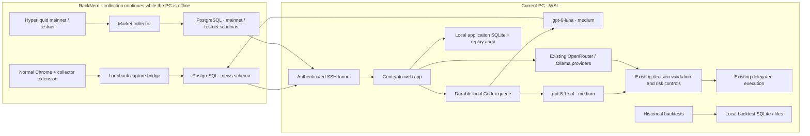

# News intelligence and VPS operations

Continuous collection runs on RackNerd. The desktop app reads the VPS PostgreSQL
database directly through SSH. Codex inference, trading execution, wallet keys,
application settings/history, and historical backtest files stay on this PC.

## Running deployment

The VPS has two CPUs and approximately 2 GB RAM. Node 22 runs isolated collector
bundles under the `centrypto` user in `/opt/centrypto-collectors`. It does not have
Codex authentication, the local app database, or trading credentials. PostgreSQL,
the capture bridge, VNC and noVNC listen on loopback. The existing unrelated VPS
proxy service is preserved.

Systemd units: `centrypto-market`, `centrypto-news-bridge`,
`centrypto-news-browser`, `centrypto-display`, `centrypto-desktop`,
`centrypto-vnc`, and `centrypto-desktop-web`. Use `systemctl status` and
`journalctl -u <unit>` over authenticated SSH. Database administration credentials
live in root-only `/etc/centrypto-collectors/credentials.json`; never copy them
into source control or browser code. The extension receives only its bridge
token. Local `.env.local` uses the limited application database role.

One signed-in browser profile supplies the installation's shared news account.
`NEWS_COLLECTOR_OWNER_ADDRESS` on both sides is its stable storage ID. It was
initialized from a wallet address, and persists when trading wallets change.
Authenticated app sessions share its sources, evidence and briefings. Trader
context uses this same news account. `configure_vps.mjs` records the storage ID
and writes ignored `data/deployment/collector-owner.txt`; upload that file
and run `collector/deploy/pair_owner.py <owner-file>` as the VPS administrator
before activation (or to update the existing bridge). No private key is involved.

The local supervisor starts the tunnel and inference worker, retries disconnected
processes, and never starts trading. Run `npm run runtime:local` in WSL, or install
the Windows logon task with `scripts/install_local_runtime.ps1`. Avoid running
the PM2 alternative and logon task together; a file lock prevents two supervisors.
Logs are in ignored `logs/intelligence/`. `npm run runtime:status` reports source,
queue, model, observation and market freshness status without credentials or raw
evidence. The app starts separately with `npm run dev`.

During the initial migration, ignored `data/deployment/market-import-request.json`
keeps the one-time history import enabled until both networks finish. The
supervisor resumes it after reconnection/logon. Its PostgreSQL cursor and each
batch commit are atomic. `logs/intelligence/history-import.log` reports progress;
`npm run runtime:status -- --migration` reads committed cursors. A supervisor HUP
restarts only inference after a code update, preserving the tunnel and import.

Tunnel ports: local `55432` to PostgreSQL `5432`, and local `6089` to noVNC `6080`.
The dedicated SSH key permits only those remote loopback services (plus the
collector bridge port for diagnostics). Do not expose PostgreSQL or VNC publicly.

## Account sign-in and sources

Open [the remote desktop](http://localhost:6089/vnc.html?autoconnect=1&resize=scale)
while the tunnel is running. Chrome runs normally, without Puppeteer control,
automation flags, network interception, or image blocking. Images can render
during login; captures and analysis contain text and media links only.
The browser profile persists at `/var/lib/centrypto-collectors/profile`.

Normal Chrome does not retain extensions loaded temporarily through the testing
browser's automation API. On first switch, load `/opt/centrypto-collectors/extension`
with **chrome://extensions → Developer mode → Load unpacked**. Check the extension
options for pairing/permissions. Subsequent browser restarts retain the installed
extension. Keep the testing browser stopped while using the same profile.

Complete passwords, CAPTCHA and 2FA yourself. Telegram sign-in does not authorize
reading all channels. Add individual channels, X accounts/lists/searches/threads,
Reddit threads, feeds, and official announcement URLs in **News intelligence →
Sources** after verifying the wallet session. Discord DMs and Telegram DMs are
rejected. New article origins may require granting that origin in extension options.
Public feeds can be seeded from `config/feeds.json` using the Sources button or
`npm run intelligence:worker -- --seed-defaults --owner <wallet>`.

The deployed curated set also uses `config/news-sources.json` (seed with
`--seed-curated`). Hyperliquid's official support guide verifies its two X
accounts and Telegram channel; Binance's community page verifies its X and
announcement channel; Federal Reserve feeds come from the Board's own RSS page.

On 2026-10-31, membership requests were submitted for two additional discussion
groups selected for news intelligence. Binance English (`@BinanceExchange`,
linked from `https://www.binance.com/en/community`) approved membership on
2026-11-01 after the account holder completed a renewed Combot verification.
The old button returned “Nothing to do”; renewing the group join request issued
a working button. The group is registered as a private, wallet-owned source at
`https://web.telegram.org/a/#-1001146170349`. The source expansion below moved it
to the five-minute community schedule after observing substantial game/bot chatter.
HypurrCo & Frens, linked from
`https://www.hypurr.co/` through `https://t.me/+kQPx4WNpHEk4MmRl`, is awaiting
administrator approval at the last check and is not registered for collection.
After that membership is confirmed, register only the selected group's exact
Telegram Web URL as a private, wallet-owned source and verify real captures.
Do not register the verification bot or other chats from the account sidebar.

Collector extension 1.0.10 reads Telegram Web A publication dates from an existing
full-date tooltip or the displayed date-group heading and original clock. The
latter preserves minute precision in the browser's timezone. The deployed UI is
English; unsupported or ambiguous date labels are excluded and reported as
incomplete extraction, rather than assigned the collection time. Metadata repair
fills only missing publication dates on the same source/message/revision. The
browser role has column-level UPDATE permission on `NewsDocument.publishedAt`,
without UPDATE permission on raw text. Initial undated setup captures remain
marked partial for audit and produced no news events.

Authenticated Telegram loads are serialized and briefly foreground the selected
group, then restore the previous tab. Extraction waits for asynchronous message
loading and uses Web A's desktop mouse-down navigation to reach the live end
before reading older messages. The scheduler drains overdue work in bounded
batches of at most two tabs. Polling targets still require observation on the VPS;
bounded history extraction can report partial coverage during busy catch-up.

The 2026-11-01 source expansion adds 18 sources across Greater China, Korea,
Japan, Taiwan and global reporting/security/research. See
[source selection and limitations](crypto-source-selection.md). RSS fetching and
XML parsing now run inside the extension using an offscreen document, avoiding
download tabs. RSS source policy can bound the historical lookback and explicitly
allow a verified publisher article host. Unsupported/future dates remain visible
as partial coverage; raw feed markup is never inserted into an active page.

The existing public announcement feeds do not require joining private chats. Reddit is treated as
community claims/opinion. Sources that cannot be accessed remain visibly
incomplete. No Discord channel is selected automatically without a specific
channel URL.

Priority sources request a one-minute cadence; ordinary sources request five
minutes, with two concurrent collection tabs. These are targets, not a claim of
complete platform-wide coverage. Every configured source reports health. Login,
challenge, permission and inaccessible-source failures pause that source until it
is resumed in the app. Parser failures retry. Normal browsing and unselected
channels are never collection tasks.

## Data and retention

`prisma/runtime-market` is PostgreSQL market storage; `prisma/news` is PostgreSQL
private news storage; `prisma/schema.prisma` remains local application SQLite;
`prisma/market` generates the separate SQLite backtest client. Generate all four
clients with `npm run prisma:generate`. Do not run the SQLite market migration
against PostgreSQL. `scripts/configure_vps.mjs` applies the PostgreSQL migrations
and configures local connections using ignored deployment credentials.

The market application role has SELECT access only. Only the VPS market worker
writes market data; API routes cannot start a local collector. Old local market
SQLite files are retained as migration sources, never used as runtime fallbacks.
`scripts/migrate_market_to_vps.py` imports read-only source batches with an atomic
PostgreSQL source cursor. An interrupted import is resumable without duplicate
ticks. Existing candle natural keys win conflicts. Do not delete source files
until independently checking the completed import.

Because news now lives directly in the VPS application database, there is no
separate seven-day transfer spool or local news mirror. Acknowledgement follows
the database commit; revision uniqueness makes capture retries idempotent.
Raw evidence expires after 30 days, unprocessed backlog is limited to 500 MB,
and derived intelligence and local replay snapshots expire after 90 days.
Retention losses are counted and displayed. Source removal deletes its evidence
and invalidates wallet-derived briefings for rebuilding. Public legacy sentiment
routes read only their original local public tables and never read private news.

## Models and staged rollout

`CODEX_CLI_PATH` points to the project-pinned Codex 0.166.0 installation under
ignored `data/deployment/codex`. The old global WSL CLI failed model compatibility;
the project installation successfully executed both exact requested models.
Use `npm run codex:check` to repeat the real structured-output preflight.
Authentication stays in the local user's normal Codex configuration.
CLI execution is local; prompts are sent to the model service through your Codex
account. Model credentials are not installed on the VPS.

The queue allows one execution, prioritizes waiting trader jobs, kills executions
after 90 seconds, and backs off quota errors. It does not interrupt a running news
job for a trader. Subprocesses get isolated working directories, a restricted
environment, schema validation, ephemeral sessions and disabled tools/integrations.
Authentication/model failures are visible; no alternate model is silently used.
Existing saved OpenRouter/Ollama strings and defaults remain valid.

The Luna output schema contains the exact frozen asset universe and current
evidence IDs, with a second semantic validator before storage. Rejected evidence
is visible and can be requeued using **Retry analysis**. `scripts/diagnose_news.ts`
prints validation codes without raw text. `scripts/evaluate_news.ts` sends a
synthetic rumor/copy/contradiction/multilingual/injection fixture through the same
local queue; it never inserts fixture evidence into the news database.

Select **Codex · GPT-6.1 Sol** in the existing model picker when its worker is
available. Provider failures create no model-generated trade. Deterministic
position management still runs through the existing workflow independently.
No eligibility, sizing, `news_blocked` or backend risk formula changes are included.

`NEWS_TRADER_CONTEXT_ENABLED=healthy` lets every trader model use analyzed,
unexpired signals immediately. Each cited document must belong to the news account and
come from an enabled, healthy source that polled successfully within three of its
polling intervals. The dashboard shows the full briefing. The trader receives
only qualifying signals and their coverage, up to 30 per run.

New installations start in `shadow` mode. This optional rollout check measures
whether polling and analysis can keep up for a full day. It requires 24 hours
of observation, at least 1,200 samples, 95% healthy samples, a fresh healthy
check and analyzed evidence. Registry changes restart the observation window.
`false` disables news context. `true` sends the full briefing immediately.
Trading runs pin their available briefing and context locally.
Availability timestamps exclude future analysis from historical contexts; expired
events remain historical but cannot enter current context.

## Verification

Run `npm run lint`, `npm run typecheck`, `npm test -- --run`,
`npm run collector:build`, and `npm run build`. Adapter fixtures, queue lifecycle,
ownership, evidence validation, model routing, observation downtime and unchanged
trading enforcement have automated coverage. Browser/account coverage must also
be checked on the actual remote browser; a fixture pass does not prove live DOM
compatibility or polling coverage. Observe VPS memory and configured source
freshness for 24 hours before declaring the requested cadence achieved.

`npm run test:market-parity` runs the existing historical screener integration
test separately against the configured market dataset. Its assertions remain
unchanged; the pre-existing rank-count discrepancy (expected 1, received 20) is a
separate issue. Local Python backtest suites remain applicable.
