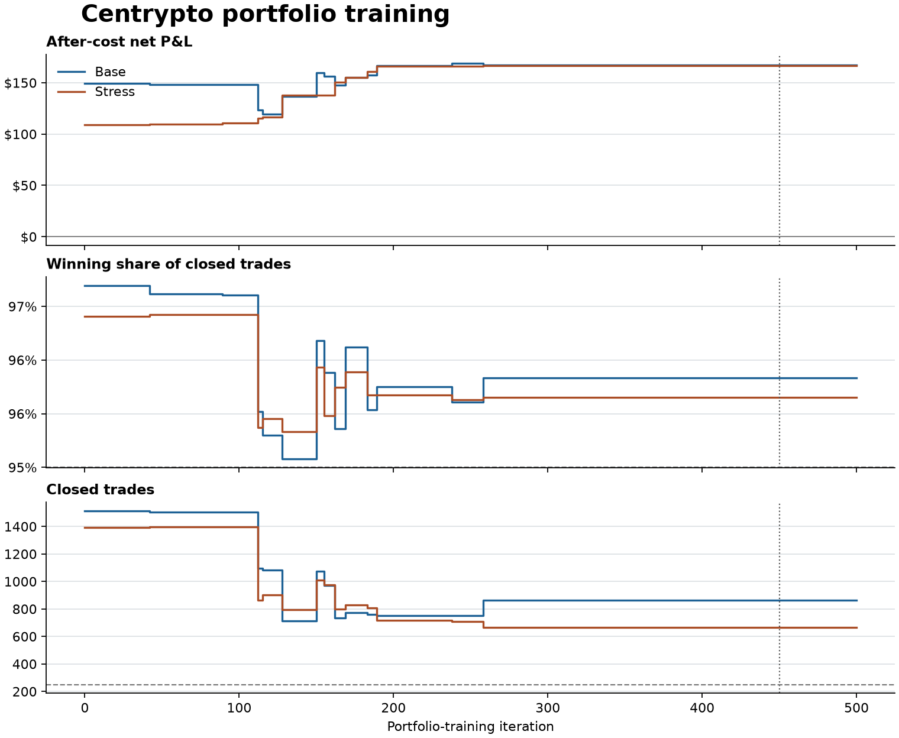

# Centrypto trading experiments, from rally labels to the 240-channel policy

Research record through November 25, 2026 · UTC dates · Simulated USD unless indicated

## Executive summary

**No evaluated model achieved positive net portfolio P&L, at least 95% after-cost winners and at least 250 closed trades in both scenarios on the three-month retrospective.** Different models achieved different parts of that goal. The ordered neural payoff model made **+$130.34 base and +$251.18 stress** on the corrected simulator, with just **21.40% and 23.50%** winners and **243 and 200** closes. The 24-channel policy optimized for the hard win-rate and trade-count floors cleared both floors and lost **$95.75 and $115.85**. The latest 240-channel model cleared the count floor, missed the win-rate floor, and lost **$97.38 and $110.31**. [Corrected payoff comparison](portfolio-entry/autonomous-entry/payoff-exits/portfolio-objective/results.json) · [Hard-floor trials](portfolio-entry/autonomous-entry/payoff-exits/portfolio-objective/worst-net-500/README.md) · [240-channel results](portfolio-entry/autonomous-entry/payoff-exits/portfolio-objective/end-to-end-240-500/README.md)

**The difference is visible in individual trades.** Under stress the 24-channel policy earned $149.01 across 1,318 winners and lost $262.34 across 64 losers. The wider model roughly doubled the average win to $0.21, but its average loss grew to $5.62. Both took only longs on the retrospective. Two shorts had contributed $148.33 of the wider model’s $166.79 stress profit in its final refit. This makes side participation and the sizes of wins and losses as important to understanding these experiments as the headline win percentage. [24-channel trade attribution](portfolio-entry/autonomous-entry/payoff-exits/portfolio-objective/worst-net-500/README.md) · [240-channel trade attribution](portfolio-entry/autonomous-entry/payoff-exits/portfolio-objective/end-to-end-240-500/results.json)

**What the controls establish.** More ridge history improved coverage but lowered returns on the short November comparison. A constant entry score with fixed exits made money in both three-month desk scenarios. A joint entry-and-exit network also made money there, but its own entries earned more with the fixed exits. Ordered market history produced an interesting profitable challenger, while earlier validation selected a snapshot design that subsequently stayed in cash. The repeatedly examined August–November dates measure retrospective behavior. The separately frozen November forward ridge experiment has a December 1 valuation cutoff. [Ridge history](ridge-357-day/README.md) · [Matched joint exits](portfolio-entry/joint-entry-exits/README.md) · [Four payoff designs](portfolio-entry/autonomous-entry/payoff-exits/README.md) · [Forward protocol](capped-entry-value/README.md)

**Find a recipe.** [Periods and baselines](#1-which-dates-and-dollars-belong-together) · [Early models](#2-rally-discovery-four-model-roles-and-label-repair) · [Ridge and history](#3-the-15-bps-ridge-the-free-archive-and-the-november-benchmark) · [Portfolio and news](#5-teaching-the-portfolio-to-say-no-and-using-the-desks-news-analysis) · [Autonomous entry](#7-autonomous-entry-and-the-250-update-win-rate-experiments) · [Counterfactual exits](#8-learning-what-an-alternative-exit-would-have-earned) · [Current architecture](#10-the-current-objective-and-the-current-network) · [Latest results](#11-hard-floors-then-240-history-channels-and-all-layers-trainable) · [Runnable commands](#reproduction-and-saved-artifacts)

## 1. Which dates and dollars belong together?

| Experiment | Fitting and selection | Evaluation |
|---|---|---|
| Early rally, classifier and SMA studies | Three discontinuous local market snapshots, with chronological folds and separate threshold selection | June and November fold replays or short November windows. Early tables use gross dollars on $100 tickets, often without shared capital |
| 28-, 218- and 357-day entry ridge | Fit before Nov 5, 2026. The longest continuous fit spans Nov 13, 2025–Nov 4, 2026. November calibration and hurdle selection follow the fit | Nov 17–20 at 12:00, 2026 entries, Nov 21 at 13:00 valuation. Previously examined development comparison |
| Three-month refitted SMA models | Entry data from Mar 2025 through Aug 6, 2026, calibration Aug 8–20. Later funded versions rebuild inputs and splits | Aug 22–Nov 21, 2026 decisions, Nov 22 valuation. Simulator, entry population and funding rules vary by generation |
| Autonomous, payoff and direct-portfolio models | Development Nov 13, 2025–Apr 30, 2026, chronological validation May 1–Aug 21, final refit Nov 13, 2025–Aug 21. The payoff study also uses earlier-date teachers | Frozen decisions Aug 22–Nov 21, 2026, ending at 21:20 UTC exclusive. Final mark Nov 22 at 21:25 UTC |
| Archived News Intelligence overlap | Early residual models adapt Nov 1–12, 2026. Later matched experiments use Nov 1–13 | Nov 14–19 decision window, Nov 20 valuation. This is a separate, much shorter evaluation |
| Original prospectively frozen ridge | Original ridge, 15 bps gate and lock preserved as challengers were added | Nov 23 at 00:00 to Nov 30 at 00:00 entry protocol, final valuation Dec 1 at 01:00 UTC. In progress on the report date |

A basis point is 0.01%. The early **15 bps** gate required a calibrated forecast above **0.15%**. It governed admission at each eligible decision. In the later desk runs a win is a **closed** trade with positive net P&L. Break-evens count in the denominator. A filled trade still open at valuation enters marked portfolio P&L and has no closed-trade win/loss outcome yet. An empty book earns $0 and has an undefined win rate. Maximum drawdown is the largest decline in marked equity from a preceding peak, in dollars. [Early protocol](capped-entry-value/README.md) · [Three-month protocol](three-month-replay/README.md) · [Late metric and valuation rules](portfolio-entry/autonomous-entry/payoff-exits/portfolio-objective/worst-net-500/README.md)

## 2. Rally discovery, four model roles and label repair

| Experiment | Recipe and architecture | Result and interpretation |
|---|---|---|
| Rally regression | Predict return after a rally signal. Compare full features, removal of correlated duplicates and aggressive relevance-based reduction on 8.98 million minute candles across three discontinuous windows | Correlation pruning helped a little. Stronger pruning impaired held-out prediction. The population was conditional on an observed rally. [Rally regression](rally-reduced-2026-11-13/REPORT.txt) |
| Two-stage entry and exit | Use a ≥10% rolling 24-hour move to identify teacher examples. Search for executable entry/exit pairs around the event, then train separate 64–32 entry and exit classifiers with balanced binary cross-entropy and 4,000 updates. Entry uses market/news and exit uses market/position state | Original long-only replay made $34.15 gross on 176 trades. The direction-aware rebuild found 355 long and 573 short events and added side and SMA information. [Two-stage report](two-stage-policy-2026-11-14/REPORT.txt) · [Direction targets](two-stage-directions-2026-11-14/target-summary.json) · [Direction rebuild](two-stage-rebuild-2026-11-14/REPORT.txt) |
| Four SMA models | Train long entry, long exit, short entry and short exit separately. Generate candidates from eight moving-average crossovers. Replay $100 tickets across the historical folds | Earlier comparator −$0.97 on 120 trades. Four-role policy +$161.36 on 157. Removing news gave +$207.73 on 236 but used about 58% more notional-hours. These are gross, exposure-dependent comparisons. [Four models](sma-four-models-2026-11-14/REPORT.txt) · [No-news control](sma-four-models-no-news-2026-11-14/REPORT.txt) |
| Feature and seed sweeps | 20 feature sets × 3 seeds × 4 folds. Two tanh layers, 32–16, balanced binary cross-entropy, Adam, L2 0.001, 4,000 updates. Swap entry weights, exit weights and threshold/cash decisions in 27 combinations | Threshold/cash selection explained roughly 72–77% of the measured decline between seeds. The +$207.73 reference changed to losses of $128.85 or $103.75 for comparison seeds. Usable historical book features were absent in outer training. [Feature sweep](feature-ablation-2026-11-14/REPORT.txt) · [Seed diagnosis](seed-diagnosis-2026-11-14/REPORT.txt) |
| Chronology and price-label repair | Audit event time, receipt time, archive boundaries, incomplete features, missing fills and labels tied to a past optimum. Rebuild chronological ensembles. Then replace the entry classification target with normalized absolute error against the hindsight entry price | Repaired ensemble +$23.11 gross on 33, concentrated in one fold. Price-error swap +$12.15 on 36 under the baseline thresholds. Independent validation for the price-error strategy selected cash. [Audit](data-label-audit-2026-11-15/REPORT.txt) · [Repair](policy-repair-2026-11-15/REPORT.txt) · [Price error](entry-price-error-2026-11-15/REPORT.txt) · [November optimizer replay](entry-optimizer-november-replay-2026-11-21.json) |
| Component swaps and rally signals | Swap spot, derivatives, volume and position-history features between sides or roles, repeat across seeds, and separately screen future rallies | On three fully priced November folds for seed 20261114, the drop-spot reference made $123.09 gross. Substituting a long entry using core features plus spot returned −$5.91. A fresh exit swap had no effect in a primary replay whose gate took only shorts. The rally follow-up counted 23 long and 154 short events. [Feature swaps](../data/research/centrypto/mixed-feature-replay-2026-11-16/results.json) · [Long swaps](../data/research/centrypto/long-model-swaps-2026-11-16/results.json) · [Fresh exit](../data/research/centrypto/fresh-long-exit-2026-11-16/results.json) · [Rally signals](../data/research/centrypto/rally-signals-2026-11-17/results.json) |
| SMA, RSI and Bollinger optimization | Test 24 configurations per side with three seeds and 4,000 Adam updates for each new fit. Choose crossover and threshold using chronological validation. Long selected SMA 3/12 and RSI(3). Short selected 3/12, RSI(7.5) and 12-bar bands | +$33.75 after costs on 38 versus +$53.97 on 33 with independently tuned no-indicator entries. Holding the crossover and thresholds fixed, indicators added $3.91 and 10 trades. A separate BTC-only five-minute test lost $4,010.69 after full costs on a $10,000 account over 409 trades. [Indicator search](sma-rsi-bb-optimization-2026-11-21/REPORT.txt) · [BTC-only test](btc-5m-sma-rsi-2026-11-21/results.json) |
| Direct after-cost payoff label | Freeze the exit ensemble, price a hypothetical entry through exit including fees and funding, and train an entry ensemble to predict this dollar payoff. Compare using the original percentile gates | The uncapped November replay returned +$120.58 on 88 trades versus +$59.35 on 43 for the price-error reference. The contemporary intelligence-enhanced price-error arm returned +$58.13 on 43. Shared capital materially changed this comparison below. [Payoff-label replay](net-value-entry-2026-11-22/historical-comparison.json) · [News-entry control](news-entry-2026-11-22/comparison.json) |

## 3. The 15 bps ridge, the free archive and the November benchmark

The first capped experiment fixed ten $100 slots, one position per symbol, and charged 4.5 bps per leg. It compared a price-error MLP, a net-payoff MLP, side-specific ridge regression, shallow LightGBM and cash. With their original percentile gates the price-error and payoff networks earned **+$55.57 on 42** and **+$52.37 on 66**. The latter used 55% more average capital. With calibrated gates the MLP earned +$109.54 at 0 bps and +$100.48 at 15 bps. Ridge earned +$105.69 on 131 and was frozen at 15 bps. The LightGBM selection chose cash after unpriced development trades. On the original tape, the side-constant made +$91.94. Tying all ridge-admitted scores made +$106.65, slightly ahead of ranking them. November 19 alone contributed $18.53 of ridge’s $13.75 advantage over constant. [Original benchmark](capped-entry-value/README.md) · [Admission and ranking audit](entry-score-audit/README.md)

**Why only 28 days?** The exporter requested three slices. A decision needed an SMA setup, a complete 24-hour native lookback, prior-minute quote volume of at least $10,000, and an outcome priced before the split. Only Apr 28–30, May 22–Jun 9 and Oct 30–Nov 4, 2026 qualified, producing 19,111 long and 11,196 short examples. The backfill combined Reservoir native traded-minute candles, reconstructed native trades and fills, settled funding, and mapped spot data where available. The resulting archive contains 111,455,405 minute candles across 539 dates and 222 symbols from Mar 22, 2025 through Nov 17, 2026. Funding reaches May 2023. Through Nov 4, 521 dates pass the basic market-coverage check on at least one asset. The longest qualifying consecutive span is 357 days. Individual asset gaps remain. [Original selection and 218-day rebuild](continuous-entry-value/README.md) · [Archive coverage and provenance](free-hyperliquid-history/README.md)

| Corrected November benchmark, identical 15 bps hurdle and exits | Fit data | Trades | Base net | Stress net |
|---|---|---:|---:|---:|
| Constant mean per side | Calibration only | 118 | +$104.23 | +$98.29 |
| 218-day ridge | Apr 1–Nov 4, 2026, 216,796 priced examples | 121 | +$96.80 | +$90.39 |
| 357-day ridge | Nov 13, 2025–Nov 4, 2026, 326,546 priced examples | 115 | +$86.14 | +$79.09 |

The 357-day fit reused the 218-day rows and added 139 earlier days. Side-specific ridge used alpha 500 and the same feature and exit definitions. The November calibration favored shorts, and the corrected benchmark’s gate admitted 1,892 shorts and zero longs for the long-history comparison. The 357-day ridge gave up $10.66 base versus 218 days and $18.09 versus constant, with lower exposure and drawdown. Changes to exit inputs and calibration distinguish this benchmark’s +$104.23 constant from the original tape’s +$91.94. [Matched comparison and ledger](ridge-357-day/README.md) · [Control audit](entry-score-audit/README.md)

## 4. News, side selection and the first three-month loss

**Long-history news started as an asset-attention measure.** The GDELT backfill found 140,606 deduplicated stories over all 357 training dates. A story mentioning the asset in the preceding four hours existed for 58.2% of decisions and 39 of 101 decision assets. On the November benchmark it found 1,413 stories across five dates, covering 47.7% of decisions and 22 of 94 assets. In the matched November ridge matrix, market-only earned +$82.48/+$75.60 base/stress, market plus availability +$88.97/+$82.19, and market plus headline content +$91.12/+$84.37. Giving content a 90-day half-life produced +$100.93/+$93.36 with $40.80 base drawdown versus the constant’s $58.03. Relative news ranking earned +$97.02/+$89.41. The standalone saved 357-day fit in §3 and the refit in this feature matrix have separate results. [Coverage by day and asset](gdelt-news-backfill/README.md) · [News, recency and ranking matrix](ridge-news-selection/README.md)

**Changing the test to three months reversed the favored side.** The team refit two ridge entries and two logistic exits on earlier history, with 391,538 priced entry examples. On the short November benchmark the calibration mean was −26.71 bps for longs and +53.28 for shorts. On Aug 8–20 it was +82.16 for longs and −70.57 for shorts. The hurdle stayed at 15 bps. For the three-month relative-news arm, all 73,613 long candidates and just 138 of 41,632 shorts passed. On the same August long candidates median exit time increased from 45 to 520 minutes when the refitted exit replaced the previous exit. The gate determined most of the imbalance before capital allocation. [Side and exit audit](three-month-replay/side-exit-audit.md)

| Aug–Nov three-month replay, ten $100 slots | Base net | Stress net | Detail |
|---|---:|---:|---|
| Constant mean per side | −$856.18 | −$920.32 | 2,521 longs, zero shorts |
| Market ridge | −$814.99 | −$874.71 | 2,475 longs, 48 shorts |
| Market plus news content | −$820.41 | −$883.14 | 2,481 longs, 43 shorts |
| News, 90-day half-life | −$785.97 | −$842.39 | 2,504 longs, zero shorts |
| News, relative ranking | −$755.77 | −$810.04 | Longs −$752.16 on 2,466, shorts −$3.61 on 45 in base |
| Same relative model, long-only | −$717.08 | −$769.84 | Separate account, 2,502 base trades |
| Same relative model, short-only | +$9.70 | +$8.21 | Separate account with the long side disabled |
| Shared ridge, pooled side calibration | −$766.85 | −$827.44 | Matched pooled constant reproduced all 2,542 base trades |
| Shared ridge, calibration by direction, news content | −$815.55 | −$896.98 | Side-specific calibration restored some score variation |

Longs supplied 99.5% of the relative model’s base net loss. Its $931.81 drawdown was a marked peak-to-trough dollar amount. The simulator allowed ten fixed $100 tickets as equity fell. Later funded books reserve equity and risk at each admission. The separate long and short results cannot be added to reconstruct the combined portfolio because they reused the same capacity independently. [Main three-month matrix](three-month-replay/README.md) · [Separate books](three-month-replay/side-only/README.md)

The shared ridge added a signed direction to one model. Pooled calibration fitted a zero slope and mapped every candidate to +28.08 bps, so tie-breaking drove admission order. Dropping Aug 19 from calibration changed every forecast to −8.70 bps and admissions to zero. The inherited SMA choices had also previously been examined on November dates. This audit prompted earlier setup selection, multiple calibration blocks, and funded allocation. [Shared-direction architecture](three-month-replay/shared-direction/README.md) · [Matched constants, sensitivity and chronology](three-month-replay/shared-direction/review.md)

## 5. Teaching the portfolio to say no, and using the desk’s news analysis

**Funded ridge.** Select long SMA 30/80 and short SMA 3/12 on early data. Fit side-specific exits on Mar 23–Sep 29, 2025. Use those exits to label 210,555 entries on 318 dates from Oct 1, 2025–Aug 20, 2026. One signed-direction ridge predicts net payoff, adverse excursion and occupied hours. Give dates and then setups equal weight, calibrate on seven expanding monthly blocks, and disable a direction when its calibration slope collapses. Train the risk model on counterfactual portfolio states, including already occupied books. Compare cash, $50 and $100 admissions, with same-side risk and time charges. The development criterion included worst-case daily net dollars less a quarter of drawdown. On the $1,000 funded test account the selected gate took zero of 89,732 opportunities. Applying the new risk allocator to the old active gate cut base loss from $486.34 to $17.03, stress loss from $486.45 to $22.25, and mean exposure from $464.43 to $64.15. The mechanism was chiefly reduced exposure. [Funded book, splits and risk labels](portfolio-entry/README.md)

**Multitask entry MLP.** Replace the ridge with 64–32–16 ReLU layers and three output targets, using a weighted standardized loss, Adam at 0.001, 20 epochs, batch 1,024 and seed 92. Hold trades, exit policy and risk model fixed. It also selected cash. Raw payoff mean absolute error increased from 227.10 to 241.03 bps, with slightly worse adverse-excursion and duration errors. [Neural comparison](portfolio-entry/deep-learning/README.md)

**Publication clock.** A story becomes usable at the first evidenced archive availability. The four indicators ask whether a visible asset story was published in the preceding 5 minutes, 30 minutes, 2 hours and 8 hours. They overlap. A four-minute-old story can turn on all four. A story received seven minutes late can turn on only the longer three at arrival. The holdout flag frequencies were 1.8%, 10.6%, 28.8% and 50.6%. The neural fixed-$100 policy then took 60 trades for +$3.16/−$3.98. Adding the portfolio risk charge yielded 13 for −$10.61/−$15.67. The development-selected allocation stayed in cash. [Timing, coverage and controls](portfolio-entry/news-timing/README.md)

**News Intelligence.** For periods with actual desk analysis, the reducer supplies bullish, bearish, mixed and neutral direction, confidence, materiality, evidence status, corrections and asset/global scope. Directional counts and confidence × materiality decay over 30-minute and four-hour half-lives. A feature becomes visible when the analysis and supporting evidence are available. The recovered Oct 31–Nov 20, 2026 archive contains 17,211 source documents, 4,258 analyses and 5,476 event revisions. Long-history models could use GDELT age flags throughout. The November overlap was the opportunity to test the richer features. [Desk reducer, fields and coverage](portfolio-entry/news-intelligence/README.md)

| November overlap, base / stress net | With News Intelligence | Matched control or comparator |
|---|---:|---:|
| Ridge news adjustment, Nov 1–12 adaptation | +$2.77 / −$10.72 | Keywords −$3.94 / −$15.91. Availability and age flags −$9.42 / −$22.03 |
| Neural news adjustment, same early experiment | −$25.87 / −$32.28 | Keywords −$8.50 / −$21.57 |
| Autonomous win-rate model, Nov 1–13 adaptation | −$6.57 / −$66.89 | Intelligence masked −$6.99 / −$50.67 |
| Counterfactual payoff model, Nov 1–13 adaptation | −$34.49 / −$29.16 | Intelligence masked −$93.45 / −$55.32 |

The latter two controls received the same additional training and retained the four publication flags. Their difference measures the incremental value of the archived analysis in that model and window. Earlier bracket runs also tested intelligence-adapted entries. The adaptive ridge returned +$75.63/+$67.95 versus adaptive constant +$61.93/+$68.47 and fixed constant +$112.62/+$97.77. The joint entry-and-exit network’s November continuation earned +$67.73/+$63.48 against the same fixed constant’s +$112.62/+$97.77. The sign and size of the benefit changed with model and scenario. [Ridge/MLP news adjustments](portfolio-entry/news-intelligence/README.md) · [Adaptive brackets](portfolio-entry/adaptive-exits/README.md) · [Joint November continuation](portfolio-entry/joint-entry-exits/README.md) · [Autonomous matched fine-tune](portfolio-entry/autonomous-entry/README.md) · [Payoff matched fine-tune](portfolio-entry/autonomous-entry/payoff-exits/README.md)

## 6. Fixed brackets, adaptive grids and the first joint network

The later desk experiments start with **$1,245**. Mandate v17 allows 1× gross exposure, up to $250 per order and symbol, ten simultaneous positions, $6.225 planned risk per trade including the 0.50% sizing cost allowance, $50 aggregate open risk, and a $24.90 daily loss threshold for new entries. A wider stop reduces notional. Entries must meet the order minimum and candle liquidity test. A 3.50% stop plus 0.50% allowance permits about $155.63 before other constraints. A gap can exceed planned risk. Historical candles provide a turnover proxy for depth, with at most 1% participation in the preceding bar. They cannot verify the live executable-depth condition. [Mandate and execution model](portfolio-entry/bracket-exits/README.md)

**Base and stress are two executions of the policy.** In the later models base uses the next eligible minute open and 1 bp adverse slippage per leg. Stress adds one minute of entry delay and uses 3 bps per leg. Both charge 4.5 bps per leg and apply available settled funding. A stop takes precedence if stop and target touch in the same minute. A gapped stop can execute at the worse opening price. Each scenario can resize, occupy different slots and make different later trades, so stress can sometimes finish ahead. Earlier November comparisons used a fixed-order delay stress. [Later simulator](portfolio-entry/bracket-exits/README.md) · [Earlier fixed-order comparison](ridge-news-selection/README.md)

| Three-month desk comparison | Training and inference recipe | Base net | Stress net |
|---|---|---:|---:|
| Fixed brackets, constant entry | Search 25 TP/SL pairs per side, combine nine finalists over three development books, Nov 13–Jan 31. Selected long target/stop 0.50%/3.50%, short 5.00%/3.50%. Barrier exits, no holding limit | +$72.95 | +$8.27 |
| Protective-stop comparator, constant entry | Existing learned exit with protective stop | −$449.02 | −$737.83 |
| Fixed brackets, retrained ridge or neural entry | Reprice entries under chosen exits and refit entry gate | $0.00 | $0.00 |
| Conditional discrete brackets, constant entry | On 51,504 opportunities fit side-specific regressors to the relative value of 25 risk-sized brackets. Two chronological folds selected shallow extremely randomized trees over ridge | −$17.83 | +$7.62 |
| Unconditional pair learned from the same adaptive labels | One pair per side with the same entry opportunities | −$122.03 | +$40.99 |
| Joint model, continuous conditional exits | Shared 48–24 MLP accepts market state and signed direction. Three outputs predict payoff and continuous TP/SL. Fit a smooth surface through the 25 counterfactual net outcomes per candidate, optimize risk-sized return plus auxiliary payoff error, using 176,054 opportunities | +$86.97 | +$30.46 |
| Same joint entry scores, former fixed exits | Hold entry forecasts and controls fixed. The replacement exits can still change sizes, holding periods and later fills | +$88.64 | +$43.72 |
| Constant entry, joint model’s learned exits | Hold the conditional exit functions and replace the entry ordering | −$501.82 | −$610.62 |

The first joint model constrained targets to 50–500 bps and stops to 25–350 bps and retained the 15 bps hurdle. Its learned brackets closed 226/224 trades at 44.25%/42.41% wins in base/stress. The fixed-bracket constant closed 1,196/1,145 at 51.92%/52.84%, with drawdowns of $367.35/$420.36. The matched swap gave the joint entries higher P&L with fixed exits in both scenarios. [Fixed search and controls](portfolio-entry/bracket-exits/README.md) · [Adaptive grid](portfolio-entry/adaptive-exits/README.md) · [Joint model and matched swaps](portfolio-entry/joint-entry-exits/README.md)

## 7. Autonomous entry and the 250-update win-rate experiments

The next network observed **every eligible completed five-minute bar** without requiring an SMA crossover, a setup age or the 15 bps gate. Across the assembled tape there were 794,288 decisions. A four-layer **128–96–64–32 tanh MLP** produced three logits for long, short and pass, plus four latent values for directional TP/SL. The three logits became action probabilities. Each exit multiplier was greater than one, and the fill price was multiplied or divided to obtain a positive barrier on the appropriate side. Brackets remained fixed from fill. Desk limits sized orders from stop distance. In training the policy sampled actions and exit parameters and used a policy gradient over full portfolio rollouts. At evaluation it chose the highest-probability action and prioritized stronger entries. [Network, simulator and training manifest](portfolio-entry/autonomous-entry/README.md)

| Frozen three-month replay | Closed base / stress | Win rate base / stress | Base net | Stress net |
|---|---:|---:|---:|---:|
| Win rate only, 16 development updates, validation selected 10 | 4,057 / 3,671 | 65.49% / 65.21% | −$943.16 | −$976.80 |
| Win rate only, 250 updates | 6,275 / 5,559 | 96.41% / 96.22% | −$286.07 | −$424.44 |
| Joint loss, 250 updates | 4,374 / 3,971 | 67.63% / 67.62% | −$946.24 | −$1,055.56 |
| Same joint loss, 250 updates, SL capped at 5% | 3,133 / 3,085 | 41.27% / 41.43% | −$753.73 | −$778.56 |

The original loss was one minus the proportion of positive after-cost closes. The joint loss minimized negative worst-case return plus equally weighted shortfalls below 95% wins and a horizon-adjusted fill target. The 250-update trials used a fixed full-refit budget through Aug 21. The training fill target scaled to about 767 for that longer period. The test applied a 250-**fill** floor. That earlier rule differs from the current 250-**closed-trade** minimum. Trades occupied capital across training batches. At cutoff, normal barriers were processed first, pending entries canceled, and remaining positions closed at the last observed minute close with fees and slippage. The forced outcomes entered the loss. In the capped run, the audit found zero backtest stops at the 5% limit. Retraining changed the policy itself. [Initial policy](portfolio-entry/autonomous-entry/README.md) · [250 win-only](portfolio-entry/autonomous-entry/iterations-250/backtest.json) · [250 joint](portfolio-entry/autonomous-entry/joint-loss-250-win-1-fills-1/backtest.json) · [5% cap audit](portfolio-entry/autonomous-entry/joint-loss-250-win-1-fills-1-sl-5pct/backtest.json)

## 8. Learning what an alternative exit would have earned

1. **Generate comparable labels.** For the same historical state and direction, sample 16 continuous target/stop pairs around 60-minute realized volatility, stratified in log space over 0.25–16 times volatility. Price each pair under base and stress through subsequent minute candles. The label is net payoff per submitted dollar after costs. Infeasible or unfilled orders earn zero. Training survivors close at cutoff.
2. **Fit a two-output value estimator.** A shared context network embeds the state into 32 values. Append the side and the two proposed normalized log distances. A 48-unit tanh layer feeds two expected payoff outputs, one per scenario. Fit squared error with Adam, seed 92, batch 512 and 250 updates per fit.
3. **Fit four exit functions.** A teacher using only earlier dates scores the candidate brackets at their desk-permitted sizes. For each side, choose the bracket with the highest lower-of-base-and-stress predicted dollars. Train the exit functions to reproduce the selected log distances. A teacher fitted before Mar 1 scored Mar–Apr. A teacher fitted before May 1 scored May–Aug. This avoids using the realized winner on the same future path as the target for imitation.
4. **Make an entry decision.** At inference the exit functions give continuous long and short brackets. Score each proposed bracket with the value model, multiply its lower scenario forecast by feasible size and compare it with pass at $0. The corrected allocator recalculates sizes and rankings after every reservation. [Payoff design, model bundles and labels](portfolio-entry/autonomous-entry/payoff-exits/README.md) · [Value and exit architecture](portfolio-entry/autonomous-entry/payoff-exits/payoff_models.py) · [Corrected replay](portfolio-entry/autonomous-entry/payoff-exits/portfolio-objective/README.md)

| Same retrospective, original matched simulator | Learned exits base / stress | Fixed per-side exits base / stress |
|---|---:|---:|
| Snapshot, named coefficients and volatility interactions | $0 / $0 | $0 / $0 |
| Snapshot, shared MLP and four neural exit heads | $0 / $0 | $0 / $0 |
| Ordered 24 bars, named coefficients for features and lags | −$155.87 / −$179.11 | −$151.71 / −$113.79 |
| Ordered 24 bars, causal convolutions and four neural exit heads | +$205.07 / +$251.18 | +$112.12 / +$288.95 |

These controls preserved entry proposals and ranking and substituted fixed exits fitted on training data. With the original simulator, conditioning exits on state helped the ordered neural base case and hurt the stress case. In base, its median stop widened from 1.59% in the middle volatility group to 4.28% in the high group. The **subsequent capacity correction** changed learned ordered-neural base P&L to **+$130.34**, with **52 wins / 243 closes**, and retained **+$251.18 stress**, with **47 wins / 200 closes** and two positions open. The original fixed-control dollars belong to the original simulator. Validation had selected the snapshot neural model at −$233.33 worst-case versus −$441.37 for ordered neural. The ordered result is a retrospective challenger. [Original two-by-two and volatility buckets](portfolio-entry/autonomous-entry/payoff-exits/README.md) · [Corrected counts and returns](portfolio-entry/autonomous-entry/payoff-exits/portfolio-objective/README.md)

## 9. Direct portfolio optimization, initialization and continuation

The next experiment retained the 24-channel ordered encoder and directly searched six heads over full base and stress portfolio replays. The two entry outputs became ranking preferences per unit of exposure. Four other heads set continuous directional exits. A positive preference was multiplied by feasible size, and cash had score zero. The initial criterion favored candidates reaching all strategy targets, then the smaller closed count capped at 250, then the sum of the lower scenario net return on $1,245 and the lower scenario win fraction. It could therefore prefer a policy that earned fewer dollars if win rate or trade count improved. [Direct portfolio recipe](portfolio-entry/autonomous-entry/payoff-exits/portfolio-objective/README.md)

| Frozen encoder, three-month backtest | Base net | Stress net | Closed base / stress | Win rate base / stress |
|---|---:|---:|---:|---:|
| Cold heads, selected iteration 150 of 250 | −$362.80 | −$194.05 | 688 / 696 | 62.65% / 65.95% |
| Fitted heads, selected iteration 150 | +$36.38 | −$41.14 | 291 / 299 | 72.85% / 75.59% |
| Fitted heads, iteration 250 | +$76.96 | −$10.99 | 221 / 215 | 74.21% / 71.16% |
| Same fit continued, iteration 450 | −$15.14 | −$15.12 | 276 / 251 | 76.45% / 74.10% |
| Same fit continued, iteration 500 | −$8.06 | −$26.08 | 277 / 226 | 76.90% / 73.45% |

**Initialization mattered.** At the selected cold refit only one proposed update had been accepted. Only the two short-exit heads had changed. For the warm fit, initialize the four heads from fitted exit functions, regress the two preferences on the prior conservative payoff forecasts, and initialize thresholds from the training distribution. All six heads then changed. The continuation recovered the random state, reproduced the first 250 weight checkpoints, and continued the same search to 500. Iteration 150 remained the chronological validation winner. [Cold fit](portfolio-entry/autonomous-entry/payoff-exits/portfolio-objective/README.md) · [Warm fit](portfolio-entry/autonomous-entry/payoff-exits/portfolio-objective/fitted-heads/README.md) · [Continuation and curves](portfolio-entry/autonomous-entry/payoff-exits/portfolio-objective/fitted-heads-500/README.md)

**What changed from 250 to 500?** Worst-case **in-sample refit** P&L rose from +$388.68 to +$428.85. On the retrospective, base fell $85.02 and stress fell $15.09. Base short profit fell from +$139.85 to +$45.31. Crossed replays using 250’s entries and 500’s exits earned +$9.40/+$53.26. Using 500’s entries and 250’s exits earned +$67.17/−$24.58. Changing only one component altered later exposure and admissions. The divergence is evidence of weak generalization. It also exposes a real trade-off in the old objective, which rewarded rising win rates or counts alongside profit. [Entry/exit substitutions and trade attribution](portfolio-entry/autonomous-entry/payoff-exits/portfolio-objective/fitted-heads-500/continuation-diagnostics.json)

## 10. The current objective and the current network

For scenario s, let P_s be marked net dollars, N_s closed trades and W_s positive after-cost closes. Both scenarios must satisfy these constraints for the optimizer to rank policies solely by profit.

~~~text
maximize    min(P_base, P_stress)
subject to  N_s ≥ 250 and 100 × W_s ≥ 95 × N_s, separately for base and stress
~~~

Before a candidate qualifies, compare its relative attainment of each floor, capped at one. Improve the weaker attainment first, then the other, then worst-case dollars. Keep the earlier checkpoint on an exact tie. The strategy’s historical success criterion also requires positive net P&L in each scenario. A policy can thus meet both mathematical constraints while losing money. [Objective and selection rules](portfolio-entry/autonomous-entry/payoff-exits/portfolio-objective/worst-net-500/README.md)

### From market state to six outputs

| Component | Latest 240-channel implementation |
|---|---|
| Snapshot | 38 active fields. Returns across five horizons, volatility and ratios, volume, BTC/ETH context and relative returns, SMA levels and gaps, RSI, Bollinger bands, location within the bar, time of day and four GDELT flags. Separate archived intelligence slots are inactive on the full historical run |
| Ordered input | 24 completed five-minute bars, oldest first. Each has 12 fields covering price moves relative to the open or previous close, quote volume, BTC and ETH five-minute returns and the four as-of news flags. This is two hours of observations |
| History encoder | Four causal one-dimensional convolutions, kernel size 3, dilations 1, 2, 4, 8, tanh, **240 learned channels per layer**. The previous encoder had 24. Channels are learned filters. The number of historical bars remains 24 |
| Shared representation | Concatenate the most recent history embedding with the snapshot, then four dense tanh layers of 128, 96, 64 and 32 units. The encoder has 590,272 parameters. Standardized current snapshot features also feed the output heads alongside the 32 learned values |
| Trading outputs | Two signed entry preferences, long and short, plus four independent outputs for long TP, long SL, short TP and short SL. Pass is fixed at zero. The latest portfolio search learns preferences directly from portfolio outcomes, so their magnitudes have no calibrated probability or dollar interpretation |
| Depth and weights | Four convolutional layers, four dense hidden layers and a final six-output linear map. The longest input-to-output path has nine learned layers. Each exit has its own coefficient vector and intercept. They share the upstream representation |

[Exact snapshot fields](portfolio-entry/autonomous-entry/dataset.json) · [Ordered bars](portfolio-entry/autonomous-entry/payoff-exits/payoff_history.py) · [Context architecture](portfolio-entry/autonomous-entry/payoff-exits/payoff_models.py) · [Wide encoder and scoring](portfolio-entry/autonomous-entry/payoff-exits/train_end_to_end.py)

**The exit is a function.** Let z_t be the features reaching the heads and v_t the trailing 60-minute volatility as a fraction of price. For each of the four exits, the fitted coefficients are b_j and w_j. At entry calculate the positive log distance d_j = v_t × softplus(b_j + w_j · z_t). For a long filled at P the two prices are P × exp(d_longTP) and P × exp(−d_longSL). For a short they are P × exp(−d_shortTP) and P × exp(d_shortSL). A change in market or news inputs can change either exit for a new trade. Once filled, the order keeps both levels. The final family has no 5% stop cap and no maximum holding time. [Exit architecture](portfolio-entry/autonomous-entry/payoff-exits/train_portfolio.py)

**A quote from the saved 240-channel weights.** Using the same hypothetical $100,000 BTC fill on Aug 22, 2026, the frozen model gave the following outputs. In both states both directional preferences were negative, so it would pass. The proposed levels still show how the fitted functions respond to changed inputs. [Frozen weights](portfolio-entry/autonomous-entry/payoff-exits/portfolio-objective/end-to-end-240-500/frozen.pt) · [Quote implementation](portfolio-entry/autonomous-entry/payoff-exits/train_end_to_end.py)

| As-of decision UTC | Long target | Long stop | Short target | Short stop |
|---|---:|---:|---:|---:|
| 00:00:05 | $100,132.15 | $93,543.30 | $95,582.44 | $101,893.70 |
| 12:00:05 | $100,286.73 | $96,669.52 | $97,340.69 | $101,146.25 |

**Portfolio inference.** For each eligible asset on each completed five-minute bar, compute both directional brackets, derive each side’s feasible notional from stop loss plus cost allowance, then apply remaining risk, leverage, cash, liquidity and concentration limits. Compare positive size-weighted entry preferences against pass. Reserve the strongest feasible order, update capacity, and re-rank the remaining proposals. A fresh quote for an asset describes its proposed levels conditional on a fill. Actual admission and size require the contemporaneous portfolio. [Portfolio training and replay code](portfolio-entry/autonomous-entry/payoff-exits/train_portfolio.py) · [Desk mandate](portfolio-entry/bracket-exits/desk-mandate.json)

## 11. Hard floors, then 240 history channels and all layers trainable

**24-channel recipe.** Freeze the 24-channel causal encoder. Start from the fitted six-head initialization, with seed 92, and run **500 fresh proposals per fit** under the hard-floor objective. Each proposal is scored by replaying the actual portfolio in both scenarios. Development found no feasible checkpoint. The fallback at iteration 500 had a validation win rate of 81.47% in its weaker scenario. The final refit at that schedule earned +$149.10/+$109.27 and won 96.70%/96.41%. The frozen three-month book then won 96.08%/95.37% on 1,250/1,382 closes but lost $95.75/$115.85. Its stress median target was 0.50%, its median stop 27.15% and its median order $21.57. [24-channel selection, brackets and ledger](portfolio-entry/autonomous-entry/payoff-exits/portfolio-objective/worst-net-500/README.md)

**240-channel recipe.** Start development and refit from their own 24-channel iteration-500 weights. Expand each convolution from 24 to 240 channels by replicating channels and distributing outgoing weights so the initial function is preserved. Allow all eight hidden layers and six outputs to change. Try **500 additional proposals in each fit**, with the same constrained objective, full-period replays and desk rules. The search perturbs weights and retains improved portfolios. This derivative-free method scores the realized consequences of order admission and barrier fills. Excluding initialization, development accepted **4** proposals and final refit accepted **13**. All 16 encoder weight/bias tensors and all six output heads changed in the selected refit. Validation picked update **450 of 500** from 11 checkpoints including initialization. None met both validation floors. [Wide training code](portfolio-entry/autonomous-entry/payoff-exits/train_end_to_end.py) · [Validation rankings](portfolio-entry/autonomous-entry/payoff-exits/portfolio-objective/end-to-end-240-500/selection.json) · [Final fit](portfolio-entry/autonomous-entry/payoff-exits/portfolio-objective/end-to-end-240-500/final.json)

| 240-channel model at the validation-selected schedule | Net P&L | Wins / closed | Win rate | Max drawdown |
|---|---:|---:|---:|---:|
| Validation, base | +$131.17 | 503 / 608 | 82.73% | $74.68 |
| Validation, stress | +$130.81 | 461 / 562 | 82.03% | $51.15 |
| Full refit, in sample, base | +$167.35 | 828 / 864 | 95.83% | $58.06 |
| Full refit, in sample, stress | +$166.79 | 638 / 667 | 95.65% | $57.87 |
| Frozen three-month backtest, base | −$97.38 | 570 / 608 | 93.75% | $132.19 |
| Frozen three-month backtest, stress | −$110.31 | 535 / 574 | 93.21% | $145.58 |

**Where the money went.** The base ledger had 570 winners totaling +$123.82, 38 losers totaling −$213.82 and four open positions marked −$7.37. Stress had 535 winners totaling +$114.38, 39 losers totaling −$219.20 and three open positions marked −$5.50. Totals above use unrounded records. At the observed average stress win of $0.214 and loss of $5.620, break-even on closed trades alone would require about **96.34% wins**, even before the marked loss on remaining inventory. At the actual counts, eight additional winners in base and eleven in stress would have been needed to clear the 95% line. Clearing that line alone would still leave the dollar outcome dependent on payoff size. [Audited metrics](portfolio-entry/autonomous-entry/payoff-exits/portfolio-objective/end-to-end-240-500/results.json) · [Trade-by-trade ledger](portfolio-entry/autonomous-entry/payoff-exits/portfolio-objective/end-to-end-240-500/backtest-trades.jsonl.gz)

**Inventory and funding.** All 612 base fills and 577 stress fills were long. At valuation gross open notional was $63.02 base and $44.83 stress, with position ages of 3.16–9.44 days. The latest stress median target/stop was 0.85%/24.12%. Both backtest scenarios had 39 position-hours missing funding. In the stress refit a MEGA short contributed +$119.02 with 1,147 missing funding hours, and a CASHCAT short closed at the training cutoff for +$29.31. Seven base and six stress positions were force-closed at the refit cutoff, so every training fill has a close. The two short gains accounted for 88.9% of stress refit profit, and neither three-month book traded short. These are specific limits on what the in-sample profit can establish. [Training ledger](portfolio-entry/autonomous-entry/payoff-exits/portfolio-objective/end-to-end-240-500/training-trades.jsonl.gz) · [Backtest metrics and inventory](portfolio-entry/autonomous-entry/payoff-exits/portfolio-objective/end-to-end-240-500/results.json)

The 240-channel run improved worst-case backtest P&L by $5.53 over the strict 24-channel run, while base P&L fell $1.63 and both win rates fell below 95%. Width, permission to update the encoder and additional search iterations changed together. The observed difference cannot isolate the effect of any one of them. No configuration in this record establishes a profitable, 95%-winning, 250-close strategy in both execution scenarios on fresh dates. [Latest matched scoreboard](portfolio-entry/autonomous-entry/payoff-exits/portfolio-objective/end-to-end-240-500/README.md)

The figure tracks **in-sample** refit performance over attempted updates. The dotted line denotes the schedule chosen on earlier validation. The frozen out-of-period outcomes are in the preceding table. [Earlier warm-head continuation curve](portfolio-entry/autonomous-entry/payoff-exits/portfolio-objective/fitted-heads-500/training.png) · [Earlier hard-floor curve](portfolio-entry/autonomous-entry/payoff-exits/portfolio-objective/worst-net-500/training.png)

## 12. Related desk, news-trigger and execution experiments

These studies used different opportunities, entry-depth evidence, account rules or prompts. They document the origins of several news and stop ideas. Their returns belong to their own books.

| Study | Recipe and result |
|---|---|
| Prompted news watch | Review 389 historical event/asset passes and issue a pass or expiring watch. Of 100 watches, two triggered on the same CPI release. The main combined review stayed flat. Three repeated reviews that took the BTC short lost $4.29–$4.51 with unverified entry depth. [News-rule replay](news-rule-replay-2026-11-18/replay.md) |
| Price-trigger entry | Review 348 mature historical news calls, producing 272 watches and 118 triggers. Six met archived entry-depth requirements. Structural exits earned +$1.49 on those six and −$59.73 on 48 scorable trades in the broader modeled arm. Partial profit on the verified-entry subset earned +$2.19. [Price triggers and controls](price-trigger-replay-2026-11-18/replay.md) |
| Immediate news entry, trail and re-entry | Select 59 of 221 long-side news cases. Three had verified entry depth. Test immediate stops, trails, SMA confirmation, a 24-hour watch, re-entry and alternate bar lengths/delays. A five-minute pullback with 30-second delay earned +$16.50 on known outcomes, with two unresolved. Fifteen-minute alignment earned +$5.39. Fifteen-minute pullback with zero modeled delay earned +$17.82 on known outcomes or +$9.08 on the 14 verified-depth entries. [Immediate study](immediate-news-trailing-replay-2026-11-18/replay.md) · [24-hour re-entry](immediate-news-trailing-replay-2026-11-18/24h-news-reentry.md) · [Stop sensitivity](immediate-news-trailing-replay-2026-11-18/initial-stop-comparison.md) · [Delay and bar length](immediate-news-trailing-replay-2026-11-18/15m-pullback-zero-delay.md) |
| October reconstructed news | Classify 326 historically dated headlines, yielding 37 eligible setups. A stop at 1× 24-hour volatility produced +$11.10, versus −$0.71 at 1.5×. Two trades in each arm were unresolved. Many stories were collected later and immediate historical review was assumed. [October reconstruction](october-2026-news-stop-replay/replay.md) |
| Desk follow-up and prompting | Among 264 passed watches, 54 had directional levels and 27 would have generated two-close alerts. Fourteen expired without a recorded follow-up investigation. On the same 27 alerts, GPT-6.2 medium stayed flat. GPT-6.1 medium made +$1.37 with its own exits, high effort +$1.59, and raising the cap to $500 returned +$1.17. These measure decision handling and execution on a short cohort. [48-hour follow-up](desk-followup-48h-2026-11-19/backtest.md) · [Lead comparison](desk-followup-48h-2026-11-19/high-effort-comparison/comparison.md) · [$500 cap](desk-followup-48h-2026-11-19/test-lead-6.1-high-cap500/comparison.md) · [Prompt revision audit](lit-prompt-comparison-2026-11-17/revision-validation.json) · [Desk-turn review](latest-turn-review-2026-11-17/today-review.json) |

## Reproduction and saved artifacts

Run inside the existing WSL research checkout from its root. The longer experiments depend on the saved native market/news archives, decision cache, source hashes and earlier checkpoints. The source reports document reconstruction order. The commands below describe the archived recipes. This summary used the saved outputs and ledgers.

**Data and earlier stages.** The free-history report provides the candle/funding rebuild and verification commands. The 357-day fit first runs the archive, spot and example stages, then fits and replays. Its fit command requires fresh research output. The existing bundle supports backtest and verification. The GDELT report includes the daily and per-asset coverage files. [Free archive recipe](free-hyperliquid-history/README.md) · [357-day preparation, fit and verify](ridge-357-day/README.md) · [Saved ridge](ridge-357-day/entry-model.joblib) · [News coverage](gdelt-news-backfill/README.md) · [Restored early bundles and fold fits](RESEARCH-RESTORED.md)

**Payoff pretraining and direct portfolio search.** After preparing the autonomous decision cache, run the four-design fits and their comparison using the project Python launcher. The warm-head experiment has a separate continuation command that restores the weights and random state. The strict 24-channel experiment uses a fresh search under its own criterion. [Autonomous dataset recipe](portfolio-entry/autonomous-entry/README.md) · [Payoff runtime and fitting](portfolio-entry/autonomous-entry/payoff-exits/README.md) · [Resuming 250 to 500](portfolio-entry/autonomous-entry/payoff-exits/portfolio-objective/fitted-heads-500/README.md)

~~~sh
export OPENBLAS_NUM_THREADS=1 OMP_NUM_THREADS=2
py=data/research/python
r=reports/portfolio-entry/autonomous-entry/payoff-exits
"$py" "$r/payoff_data.py"
"$py" "$r/payoff_history.py"
for stage in snapshot ordered finish; do
  "$py" "$r/run_payoff.py" "$stage" || exit 1
done
for stage in development final evaluate; do
  "$py" "$r/train_portfolio.py" "$stage" --objective worst-net --iterations 500 || exit 1
done
"$py" "$r/portfolio_report.py" --objective worst-net --iterations 500
~~~

**240-channel fit, replay and inference.** With the preceding 24-channel stage weights and archived CUDA runtime available, train development, refit and evaluate, then generate the audit. The last command quotes the two brackets for one historical BTC state and a hypothetical fill price. [Trainer](portfolio-entry/autonomous-entry/payoff-exits/train_end_to_end.py) · [Saved 240-channel policy](portfolio-entry/autonomous-entry/payoff-exits/portfolio-objective/end-to-end-240-500/frozen.pt) · [Results and recipe](portfolio-entry/autonomous-entry/payoff-exits/portfolio-objective/end-to-end-240-500/README.md)

~~~sh
export OPENBLAS_NUM_THREADS=1 OMP_NUM_THREADS=2
export CENTRYPTO_TORCH_RUNTIME="$PWD/data/research/centrypto/payoff-exits/runtime-cu128"
py=data/research/python
r=reports/portfolio-entry/autonomous-entry/payoff-exits
for stage in development final evaluate; do
  "$py" "$r/train_end_to_end.py" "$stage" --iterations 500 || exit 1
done
"$py" "$r/report_end_to_end.py" --iterations 500
"$py" "$r/train_end_to_end.py" quote --device cpu --symbol BTC --at 2026-08-22T00:00:05Z --fill-price 100000
~~~

**How to check any claim about the latest book.** Use the backtest ledger for individual fills, side, entry and exit prices, stop, target, fees, funding, close reason and realized net. Count positive net on closed rows, count all closed rows for the denominator, and add end-of-book inventory P&L to the realized sum. The training ledger separately identifies cutoff exits. Validation rankings show why iteration 450 was frozen. The saved audit reproduced 2,378 target and stop prices from decision-time inputs. [Backtest ledger](portfolio-entry/autonomous-entry/payoff-exits/portfolio-objective/end-to-end-240-500/backtest-trades.jsonl.gz) · [Training ledger](portfolio-entry/autonomous-entry/payoff-exits/portfolio-objective/end-to-end-240-500/training-trades.jsonl.gz) · [Validation rankings](portfolio-entry/autonomous-entry/payoff-exits/portfolio-objective/end-to-end-240-500/selection.json) · [Metrics and audit](portfolio-entry/autonomous-entry/payoff-exits/portfolio-objective/end-to-end-240-500/results.json)
