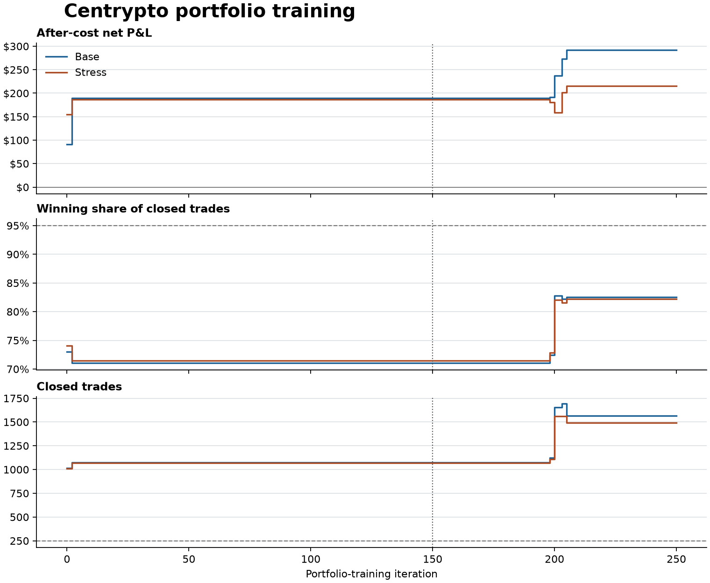

# Centrypto portfolio-objective experiment

This is the first, cold-start portfolio fit. At the selected refit checkpoint, just one candidate update had been accepted. The short exit coefficients changed, while both long exit and both entry functions retained their initial coefficients. The [fitted-head experiment](fitted-heads/README.md) follows up on that parameter audit.

Chronological validation selected iteration **150** from five checkpoints. Both the development and refit searches ran 250 iterations. The retrospective test used the frozen refit checkpoint with the same iteration number.

| Stage | Execution | Net P&L | Wins / closed | Win rate | Fills | Open | Max drawdown |
|---|---|---:|---:|---:|---:|---:|---:|
| Refit, in sample | base | +$189.75 | 764 / 1075 | 71.07% | 1075 | 0 | $108.80 |
| Refit, in sample | stress | +$186.47 | 765 / 1071 | 71.43% | 1071 | 0 | $119.51 |
| Earlier validation | base | −$211.83 | 416 / 571 | 72.85% | 571 | 0 | $226.06 |
| Earlier validation | stress | −$228.16 | 380 / 532 | 71.43% | 532 | 0 | $242.49 |
| Frozen backtest | base | −$362.80 | 431 / 688 | 62.65% | 689 | 1 | $408.78 |
| Frozen backtest | stress | −$194.05 | 459 / 696 | 65.95% | 697 | 1 | $232.20 |
| Prior ordered model, same backtest | base | +$130.34 | 52 / 243 | 21.40% | 243 | 0 | $186.00 |
| Prior ordered model, same backtest | stress | +$251.18 | 47 / 200 | 23.50% | 202 | 2 | $138.97 |

**Historical target missed.** Each execution scenario must produce positive net P&L, 95% winners and at least 250 closed trades. Break-even trades count in the denominator. The test marks remaining inventory at valuation.

| Backtest execution | Side | Wins / closed | Average win | Average loss | Realized P&L |
|---|---|---:|---:|---:|---:|
| base | long | 202 / 318 | +$2.23 | −$5.74 | −$215.01 |
| base | short | 229 / 370 | +$2.68 | −$5.38 | −$144.65 |
| stress | long | 228 / 341 | +$2.24 | −$5.61 | −$122.36 |
| stress | short | 231 / 355 | +$2.56 | −$5.33 | −$68.57 |

## What the optimizer changes

The shared encoder combines a five-minute snapshot with a causal convolution over 24 completed bars. It includes BTC/ETH context and the four GDELT publication-age flags. The payoff pretraining stops at the cutoff of each fit. The encoder then stays frozen. A derivative-free search fits two entry preference functions and four exit functions to realized portfolio outcomes. Entry preference is a ranking score per unit of exposure.

At a decision, each exit has its own weights and bias. Its log-price distance is `60-minute volatility × softplus(bias + weights · current features)`. The features include standardized market and news inputs and the encoder output. Long TP and SL multiply the actual fill by exp(+target distance) and exp(−stop distance). Shorts reverse the signs. Prices stay fixed after entry. There is no stop cap or holding timeout.

For each training iteration the proposed weights run through both execution scenarios over the full fitting period. All positions close at the training cutoff. A candidate reaching every historical target in both scenarios ranks first. The next comparison is the smaller scenario closed count, capped at 250. The next is the smaller scenario net return on $1,245 plus the smaller scenario win fraction. One percentage point of either measure has the same weight. The incumbent changes only for a strictly better result. Under the floor, increasing the smaller count takes priority.

At each decision the book chooses among long, short and pass. It multiplies each positive preference by current feasible size, reserves the best order, then re-sizes and re-ranks the remaining sides and assets. The saved desk settings allow $6.225 planned risk per trade, $50 aggregate open risk, $250 per instrument, 1× gross leverage, ten positions and a $24.90 daily loss limit. The replay includes fees, slippage and available settled funding. Candle turnover limits participation. Missing funding position-hours in the frozen book were 0 base and 10 stress.

Development trained Nov 13, 2025–Apr 30, 2026. Validation used May 1–Aug 21, 2026. The refit used Nov 13, 2025–Aug 21, 2026. Test entries ran Aug 22–Nov 21, with Nov 22 valuation. All dates are UTC. These test dates had been studied in earlier experiments.



The curves track the incumbent on the full refit window. The vertical dotted line marks the iteration chosen on earlier validation. Horizontal dashed lines mark the win and trade targets.

## Reproduce from the repository root

```sh
export OPENBLAS_NUM_THREADS=1 OMP_NUM_THREADS=2
r=reports/portfolio-entry/autonomous-entry/payoff-exits
data/research/python "$r/train_portfolio.py" development --cold-start
data/research/python "$r/train_portfolio.py" final --cold-start
data/research/python "$r/train_portfolio.py" evaluate --cold-start
data/research/python "$r/train_portfolio.py" quote --cold-start --symbol BTC --at 2026-08-22T00:00:05Z --fill-price 100000
```

[Frozen policy](frozen.pt) · [Selection](selection.json) · [Audited metrics](results.json) · [Backtest trades](backtest-trades.jsonl.gz) · [Refit iteration records](final.json)
