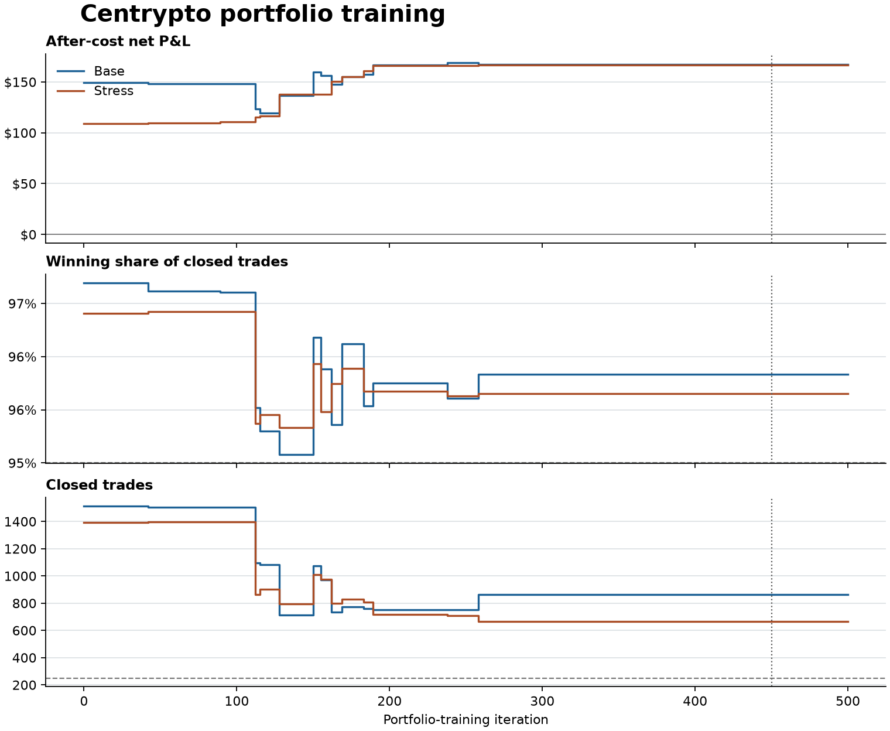

# Centrypto end-to-end wide-history backtest

The 240-channel model missed the two backtest minimums. Worst-case net P&L was **−$110.31**, a change of **+$5.53** from the previous frozen-encoder model.

Entry decisions ran from August 22 through November 21, 2026, with November 22 valuation. This is a retrospective comparison. Base used 1 bp of adverse slippage per leg. Stress used 3 bps per leg and an extra minute of entry delay. Both charged 4.5 bps in fees per leg and used the saved desk limits.

| Model or period | Execution | Net P&L | Wins / closed | Win rate | Max drawdown | Open |
|---|---|---:|---:|---:|---:|---:|
| 240-channel model, update 450 | Base | −$97.38 | 570 / 608 | 93.75% | $132.19 | 4 |
| 240-channel model, update 450 | Stress | −$110.31 | 535 / 574 | 93.21% | $145.58 | 3 |
| 24-channel frozen encoder | Base | −$95.75 | 1,201 / 1,250 | 96.08% | $135.24 | 3 |
| 24-channel frozen encoder | Stress | −$115.85 | 1,318 / 1,382 | 95.37% | $148.03 | 1 |
| Original iteration 150 | Base | +$36.38 | 212 / 291 | 72.85% | $131.47 | 2 |
| Original iteration 150 | Stress | −$41.14 | 226 / 299 | 75.59% | $139.83 | 2 |

## What changed in the trades

| Model | Execution | Side | Closed | Average win | Average loss | Realized net P&L |
|---|---|---|---:|---:|---:|---:|
| 240-channel model, update 450 | Base | Long | 608 | +$0.22 | −$5.63 | −$90.00 |
| 240-channel model, update 450 | Base | Short | 0 | — | — | +$0.00 |
| 240-channel model, update 450 | Stress | Long | 574 | +$0.21 | −$5.62 | −$104.82 |
| 240-channel model, update 450 | Stress | Short | 0 | — | — | +$0.00 |
| 24-channel frozen encoder | Base | Long | 1,250 | +$0.12 | −$4.66 | −$87.52 |
| 24-channel frozen encoder | Base | Short | 0 | — | — | +$0.00 |
| 24-channel frozen encoder | Stress | Long | 1,382 | +$0.11 | −$4.10 | −$113.34 |
| 24-channel frozen encoder | Stress | Short | 0 | — | — | +$0.00 |

- Base marked 4 open positions at −$7.37 P&L. Funding records were missing for 39 position-hours.
- Stress marked 3 open positions at −$5.50 P&L. Funding records were missing for 39 position-hours.

## Training and checkpoint selection

The network uses four causal convolutions with 240 channels each, four dense layers with 128, 96, 64 and 32 units, and six trading outputs. Each fit started at its own earlier 24-channel checkpoint at iteration 500. Replicating channels and sharing their outgoing weights preserved the initial network function up to floating-point rounding.

The optimizer tried 500 joint updates per fit. It perturbed all eight hidden layers and the output layer, replayed the complete portfolio in both scenarios, and kept improvements under the same ranking as the earlier experiment. Among candidates with at least 95% after-cost winners and 250 closed trades in each scenario, only the lower dollar P&L determined rank. Before reaching both minimums, the search prioritized closing the larger relative shortfall. Positions still open at a training or validation cutoff were liquidated for scoring.

The selected refit changed 16 of 16 encoder weight and bias tensors. It changed 6 of the six trading outputs. The encoder has 590,272 parameters.

May–August validation selected update 450 from 11 checkpoints including initialization. 0 reached both validation minimums. The selected checkpoint was the closest fallback on validation.

| Model or period | Execution | Net P&L | Wins / closed | Win rate | Max drawdown | Open |
|---|---|---:|---:|---:|---:|---:|
| Earlier validation | Base | +$131.17 | 503 / 608 | 82.73% | $74.68 | 0 |
| Earlier validation | Stress | +$130.81 | 461 / 562 | 82.03% | $51.15 | 0 |
| Final refit, in sample | Base | +$167.35 | 828 / 864 | 95.83% | $58.06 | 0 |
| Final refit, in sample | Stress | +$166.79 | 638 / 667 | 95.65% | $57.87 | 0 |

In the lower-P&L refit scenario, 2 shorts earned +$148.33, or 88.9% of that scenario's net P&L. Both three-month replays took zero shorts.

The ledger audit independently reproduced 2,378 target and stop prices from the underlying decision inputs.



The dotted line marks the update chosen on chronological validation.

## Reproduce from the repository root

The run used CUDA PyTorch 2.8.0+cu128 from an isolated research runtime.

```sh
export OPENBLAS_NUM_THREADS=1 OMP_NUM_THREADS=2
export CENTRYPTO_TORCH_RUNTIME="$PWD/data/research/centrypto/payoff-exits/runtime-cu128"
r=reports/portfolio-entry/autonomous-entry/payoff-exits
data/research/python "$r/train_end_to_end.py" development --iterations 500
data/research/python "$r/train_end_to_end.py" final --iterations 500
data/research/python "$r/train_end_to_end.py" evaluate --iterations 500
data/research/python "$r/report_end_to_end.py" --iterations 500
```

[Frozen model](frozen.pt) · [Audited metrics](results.json) · [Validation checkpoints](selection.json) · [New trade ledger](backtest-trades.jsonl.gz) · [Prior report](../worst-net-500/README.md)
