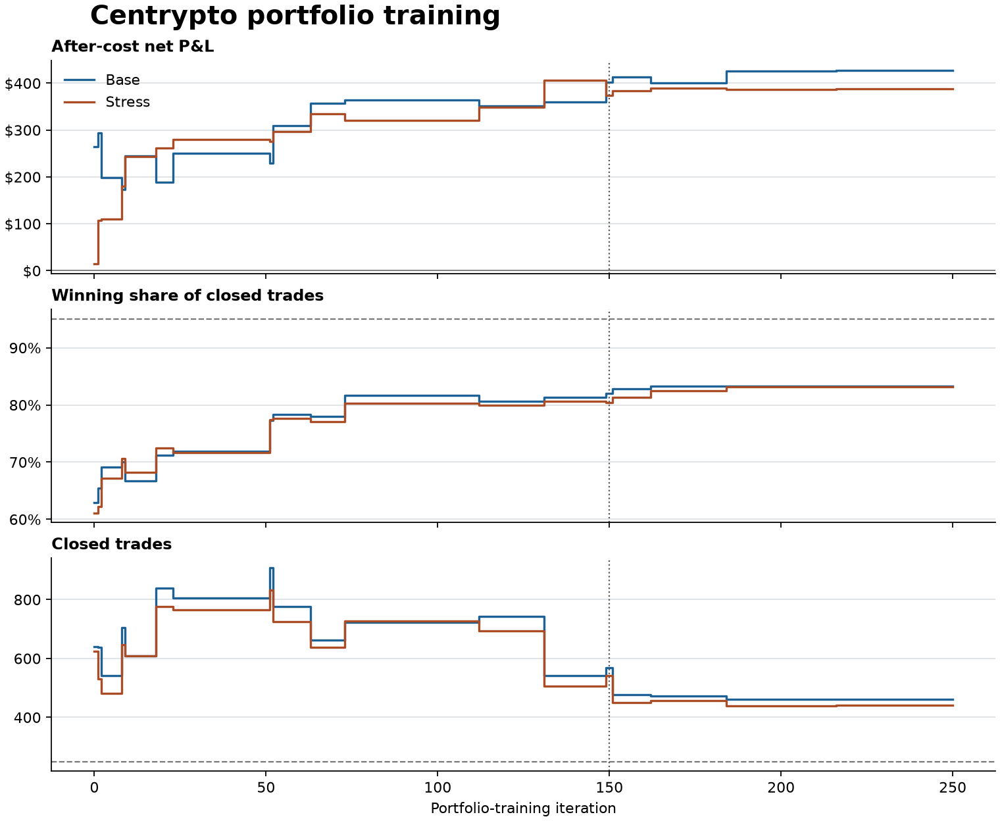

# Centrypto portfolio-objective experiment

Chronological validation selected iteration **150** from five checkpoints. Both the development and refit searches ran 250 iterations. The retrospective test used the frozen refit checkpoint with the same iteration number.

| Stage | Execution | Net P&L | Wins / closed | Win rate | Fills | Open | Max drawdown |
|---|---|---:|---:|---:|---:|---:|---:|
| Refit, in sample | base | +$401.88 | 466 / 568 | 82.04% | 568 | 0 | $59.71 |
| Refit, in sample | stress | +$373.46 | 436 / 542 | 80.44% | 542 | 0 | $55.73 |
| Earlier validation | base | +$61.14 | 408 / 550 | 74.18% | 550 | 0 | $95.62 |
| Earlier validation | stress | +$68.18 | 379 / 534 | 70.97% | 534 | 0 | $107.40 |
| Frozen backtest | base | +$36.38 | 212 / 291 | 72.85% | 293 | 2 | $131.47 |
| Frozen backtest | stress | −$41.14 | 226 / 299 | 75.59% | 301 | 2 | $139.83 |
| Prior ordered model, same backtest | base | +$130.34 | 52 / 243 | 21.40% | 243 | 0 | $186.00 |
| Prior ordered model, same backtest | stress | +$251.18 | 47 / 200 | 23.50% | 202 | 2 | $138.97 |

**Historical target missed.** Each execution scenario must produce positive net P&L, 95% winners and at least 250 closed trades. Break-even trades count in the denominator. The test marks remaining inventory at valuation.

| Backtest execution | Side | Wins / closed | Average win | Average loss | Realized P&L |
|---|---|---:|---:|---:|---:|
| base | long | 172 / 205 | +$0.44 | −$4.96 | −$88.15 |
| base | short | 40 / 86 | +$8.50 | −$4.83 | +$117.95 |
| stress | long | 197 / 226 | +$0.43 | −$5.40 | −$70.95 |
| stress | short | 29 / 73 | +$9.02 | −$5.25 | +$30.38 |

### Open positions at November 22 valuation

- Base held 2 positions with $26.49 gross notional and +$6.58 marked P&L. Their ages in days were 24.01, 10.74.
- Stress held 2 positions with $68.57 gross notional and −$0.56 marked P&L. Their ages in days were 10.74, 2.64.

The frozen refit's direct portfolio search updated 6 of the six fitted heads. Recomputing 1188 target and stop prices from individually encoded decision states reproduced the levels in the backtest ledger.

## What the optimizer changes

The shared encoder combines a five-minute snapshot with a causal convolution over 24 completed bars. It includes BTC/ETH context and the four GDELT publication-age flags. The payoff pretraining stops at the cutoff of each fit. The encoder then stays frozen. A derivative-free search fits two entry preference functions and four exit functions to realized portfolio outcomes. All four exit functions start from the earlier-date fitted neural exit functions. Both entry preferences start from regressions on the prior conservative payoff forecasts. A training-only starting threshold takes the top percentile for each side and is free to move during optimization. Entry preference is a ranking score per unit of exposure.

At a decision, each exit has its own weights and bias. Its log-price distance is `60-minute volatility × softplus(bias + weights · current features)`. The features include standardized market and news inputs and the encoder output. Long TP and SL multiply the actual fill by exp(+target distance) and exp(−stop distance). Shorts reverse the signs. Prices stay fixed after entry. There is no stop cap or holding timeout.

With an identical hypothetical BTC fill of $100,000, the frozen policy gave these prices on August 22, 2026.

| Decision UTC | Long TP | Long SL | Short TP | Short SL |
|---|---:|---:|---:|---:|
| 00:00:05 | $101,028.24 | $95,547.70 | $95,684.70 | $102,439.00 |
| 12:00:05 | $100,574.83 | $97,703.25 | $97,829.00 | $101,200.38 |

For each training iteration the proposed weights run through both execution scenarios over the full fitting period. All positions close at the training cutoff. A candidate reaching every historical target in both scenarios ranks first. The next comparison is the smaller scenario closed count, capped at 250. The next is the smaller scenario net return on $1,245 plus the smaller scenario win fraction. One percentage point of either measure has the same weight. The incumbent changes only for a strictly better result. Under the floor, increasing the smaller count takes priority. The search takes smaller parameter steps after a sequence of unsuccessful trials.

At each decision the book chooses among long, short and pass. It multiplies each positive preference by current feasible size, reserves the best order, then re-sizes and re-ranks the remaining sides and assets. The saved desk settings allow $6.225 planned risk per trade, $50 aggregate open risk, $250 per instrument, 1× gross leverage, ten positions and a $24.90 daily loss limit. The replay includes fees, slippage and available settled funding. Candle turnover limits participation. Missing funding position-hours in the frozen book were 34 base and 16 stress. The validation figures were 1,622 and 0. The refit figures were 217 and 255. The P&L includes recorded funding only.

Development trained Nov 13, 2025–Apr 30, 2026. Validation used May 1–Aug 21, 2026. The refit used Nov 13, 2025–Aug 21, 2026. Test entries ran Aug 22–Nov 21, with Nov 22 valuation. All dates are UTC. These test dates had been studied in earlier experiments. The [first portfolio fit](../results.json) also used these dates. Inspection of its selected refit found that only one proposal had been accepted and four of six heads retained their initial coefficients. This run initializes all six heads from fitted models.



The curves track the incumbent on the full refit window. The vertical dotted line marks the iteration chosen on earlier validation. Horizontal dashed lines mark the win and trade targets.

## Reproduce from the repository root

```sh
export OPENBLAS_NUM_THREADS=1 OMP_NUM_THREADS=2
r=reports/portfolio-entry/autonomous-entry/payoff-exits
data/research/python "$r/train_portfolio.py" development
data/research/python "$r/train_portfolio.py" final
data/research/python "$r/train_portfolio.py" evaluate
data/research/python "$r/portfolio_report.py"
data/research/python "$r/train_portfolio.py" quote --symbol BTC --at 2026-08-22T00:00:05Z --fill-price 100000
```

To price exits from a current state, use `quote --state-file state.json --fill-price PRICE`. The [example BTC state](example-state.json) reproduces the first row of the inference example. Supply a `snapshot` object keyed by the [market and news fields](../../../dataset.json) in `columns`, and a `bars` array of 24 completed five-minute feature objects in oldest-first order using [HISTORY_COLUMNS](../../payoff_history.py). The command returns proposed levels for both directions. The portfolio replay separately evaluates feasibility and chooses among long, short and pass.

[Frozen policy](frozen.pt) · [Selection](selection.json) · [Audited metrics](results.json) · [Backtest trades](backtest-trades.jsonl.gz) · [Refit iteration records](final.json)
