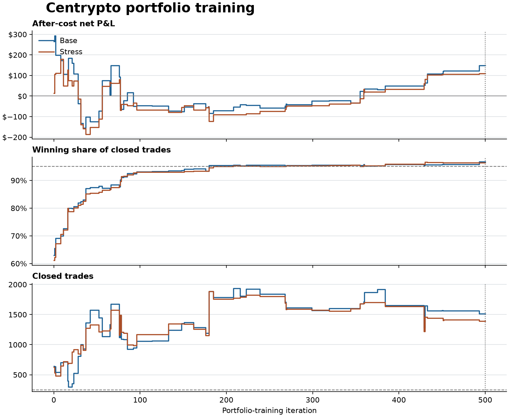

# Worst-case portfolio P&L with win-rate and trade-count minimums

All 10 validation checkpoints missed at least one minimum. Iteration 500 was the closest on validation and is shown as an unqualified comparison. The new model's worst-case backtest P&L was **−$115.85**, a change of **−$74.71** from the original iteration 150. The new model met the two backtest minimums.

## Three-month backtest

Entry decisions ran from August 22 through November 21, 2026. Valuation used November 22 at 21:25 UTC. This is a retrospective comparison on previously studied dates. Each replay started with $1,245. Base used the next minute's open and 1 bp of adverse slippage per leg. Stress used the following minute's open and 3 bps per leg. Both charged 4.5 bps in fees per leg and used the saved desk limits.

| Model or stage | Execution | Net P&L | Wins / closed | Win rate | Max drawdown | Open |
|---|---|---:|---:|---:|---:|---:|
| New iteration 500 | Base | −$95.75 | 1,201 / 1,250 | 96.08% | $135.24 | 3 |
| New iteration 500 | Stress | −$115.85 | 1,318 / 1,382 | 95.37% | $148.03 | 1 |
| Original iteration 150 | Base | +$36.38 | 212 / 291 | 72.85% | $131.47 | 2 |
| Original iteration 150 | Stress | −$41.14 | 226 / 299 | 75.59% | $139.83 | 2 |

### Exit distances on filled orders

| Model | Execution | Median take-profit distance | Median stop distance | Median order size |
|---|---|---:|---:|---:|
| New 500 | Base | 0.51% | 27.36% | $21.65 |
| New 500 | Stress | 0.50% | 27.15% | $21.57 |
| Original 150 | Base | 1.36% | 10.71% | $44.82 |
| Original 150 | Stress | 1.40% | 11.90% | $42.56 |

### Closed trades by direction

| Model | Execution | Side | Wins / closed | Average win | Average loss | Realized net P&L |
|---|---|---|---:|---:|---:|---:|
| New 500 | Base | Long | 1201 / 1250 | +$0.12 | −$4.66 | −$87.52 |
| New 500 | Base | Short | 0 / 0 | — | — | +$0.00 |
| New 500 | Stress | Long | 1318 / 1382 | +$0.11 | −$4.10 | −$113.34 |
| New 500 | Stress | Short | 0 / 0 | — | — | +$0.00 |
| Original 150 | Base | Long | 172 / 205 | +$0.44 | −$4.96 | −$88.15 |
| Original 150 | Base | Short | 40 / 86 | +$8.50 | −$4.83 | +$117.95 |
| Original 150 | Stress | Long | 197 / 226 | +$0.43 | −$5.40 | −$70.95 |
| Original 150 | Stress | Short | 29 / 73 | +$9.02 | −$5.25 | +$30.38 |

Under stress, the new policy's 1,318 winning closes earned +$149.01 in total. Its 64 losing closes contributed −$262.34. Open positions contributed −$2.51 at valuation.

### Positions and funding at valuation

- New 500, base had 3 open positions, $29.80 gross notional and −$8.23 marked P&L. Ages in days were 11.00, 9.44, 6.35. Funding was missing for 55 position-hours.
- New 500, stress had 1 open position, $10.51 gross notional and −$2.51 marked P&L. It had been open for 6.35 days. Funding was missing for 0 position-hours.
- Original 150, base had 2 open positions, $26.49 gross notional and +$6.58 marked P&L. Ages in days were 24.01, 10.74. Funding was missing for 34 position-hours.
- Original 150, stress had 2 open positions, $68.57 gross notional and −$0.56 marked P&L. Ages in days were 10.74, 2.64. Funding was missing for 16 position-hours.

Net P&L includes realized trades and marked open positions after fees, slippage and recorded funding. The win-rate denominator includes break-even closes. An open position contributes to net P&L and enters the win-rate calculation only once it closes.

## Training and selection

Each fit ran 500 fresh portfolio-search updates from the original fitted initialization with seed 92. Development used November 13, 2025 through April 30, 2026. Validation used May 1 through August 21. The final fit used November 13 through August 21. All dates are UTC. The validation-selected iteration determined which final weights to freeze. [Original fitted initialization](../fitted-heads/README.md)

Both scenarios must independently close at least 250 trades and have at least 95% after-cost winners. The exact check uses integer counts. For qualifying policies the objective is the smaller of base and stress net P&L in dollars. During the search for feasibility, each minimum is scored by its fraction attained, capped at one. The search improves the lower fraction first, then the other, then worst-case dollars. An exact tie keeps the earlier checkpoint.

| Model or stage | Execution | Net P&L | Wins / closed | Win rate | Max drawdown | Open |
|---|---|---:|---:|---:|---:|---:|
| Earlier validation | Base | +$74.35 | 444 / 545 | 81.47% | $75.53 | 0 |
| Earlier validation | Stress | +$93.39 | 468 / 572 | 81.82% | $58.20 | 0 |
| Final refit, in sample | Base | +$149.10 | 1,463 / 1,513 | 96.70% | $57.17 | 0 |
| Final refit, in sample | Stress | +$109.27 | 1,342 / 1,392 | 96.41% | $58.87 | 0 |

Missing funding totaled 1,622 base and 1,622 stress position-hours on validation, and 1,557 base and 1,395 stress position-hours in the final refit.

- Development evaluated the initialization and 500 updates without meeting both minimums. The weaker win rate at update 500 was 79.89%, with at least 731 closed trades per scenario.
- Full refit first met both minimums at update 185. By update 500, its best qualifying in-sample worst-case P&L was +$109.27.



The dotted line marks the iteration selected on earlier validation. The dashed lines mark the two minimums.

## Reproduce

```sh
export OPENBLAS_NUM_THREADS=1 OMP_NUM_THREADS=2
r=reports/portfolio-entry/autonomous-entry/payoff-exits
data/research/python "$r/train_portfolio.py" development --objective worst-net --iterations 500
data/research/python "$r/train_portfolio.py" final --objective worst-net --iterations 500
data/research/python "$r/train_portfolio.py" evaluate --objective worst-net --iterations 500
data/research/python "$r/portfolio_report.py" --objective worst-net --iterations 500
```

The independent ledger audit reconstructed exits, fees, available funding and marked P&L. Recomputing 5,272 target and stop prices from individual decision states reproduced the new backtest brackets. Every trade in the original iteration-150 replay matched its archived ledger.

[Frozen weights](frozen.pt) · [Validation rankings](selection.json) · [Audited metrics](results.json) · [New trades](backtest-trades.jsonl.gz) · [Original iteration 150 trades](reference-150-trades.jsonl.gz)
